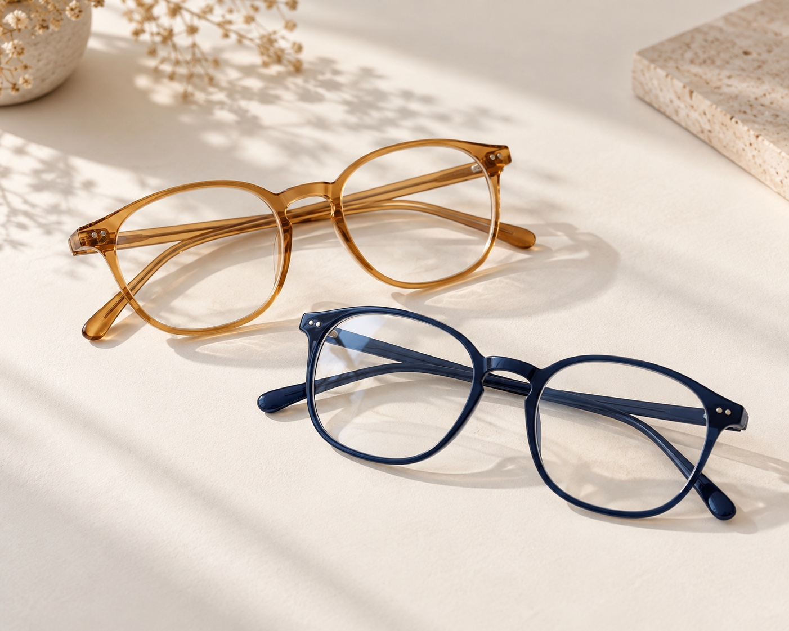
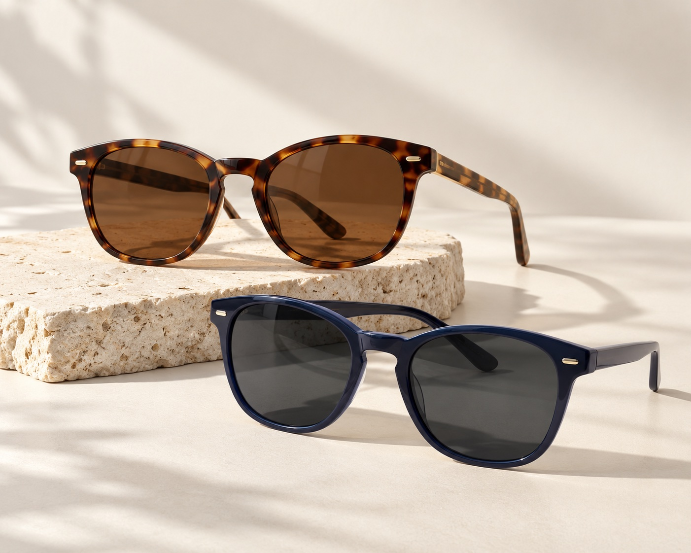
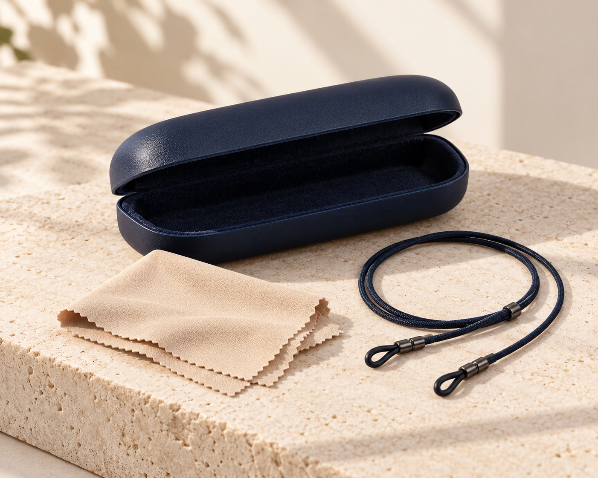
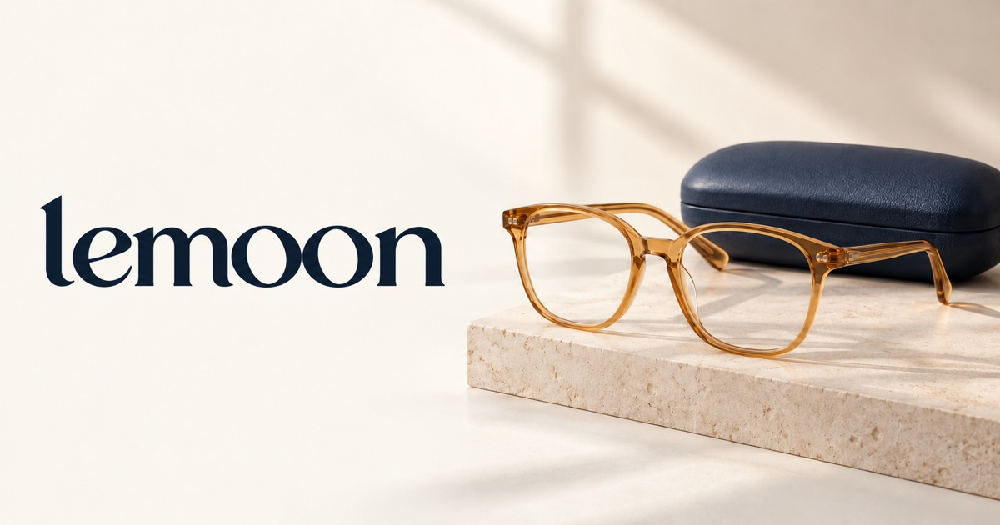
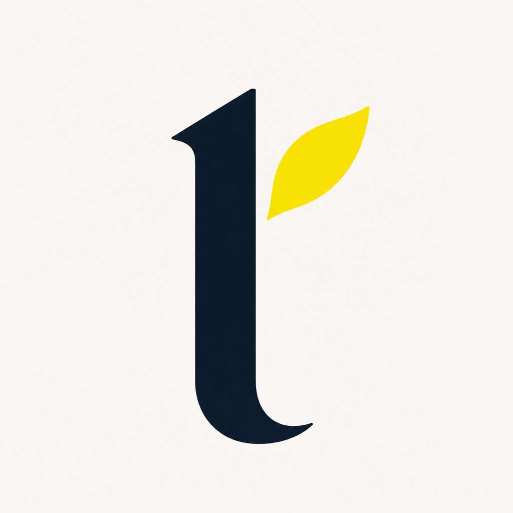
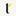

# LEM-97 · galería de exports generados

Paquete gráfico generado para Lemoon, guardado en el proyecto; sin carga CMS, integración Liquid ni publicación. Solo tres categorías principales: son escenas genéricas generadas, **no SKU del catálogo**, fotos de stock ni evidencia de productos disponibles. No hay subcategorías ni banners delgados nuevos.

## Galería y archivos

Las miniaturas enlazan los archivos optimizados de `assets/`. Los bytes corresponden al archivo local, no al peso servido por CDN. JPG calidad 85; PNG opacos, sin transparencia añadida.

| Pieza / preview | Archivo | Dimensiones | Bytes | Descripción / alt sugerido |
| --- | --- | --- | --- | --- |
| H02-O · Ópticos  | [lemoon-category-opticos-generic-v1.jpg](../../../../assets/lemoon-category-opticos-generic-v1.jpg) | 1402×1122 | 341,604 | Armazones ópticos color miel y azul sobre una superficie clara. |
| H02-S · Sol  | [lemoon-category-sol-generic-v1.jpg](../../../../assets/lemoon-category-sol-generic-v1.jpg) | 1402×1122 | 312,799 | Lentes de sol carey y azul sobre una superficie clara. |
| H02-A · Accesorios  | [lemoon-category-accesorios-generic-v1.jpg](../../../../assets/lemoon-category-accesorios-generic-v1.jpg) | 1402×1122 | 457,469 | Estuche azul, paño beige y cordón para lentes. |
| G03 · OG  | [lemoon-og-default-v1.jpg](../../../../assets/lemoon-og-default-v1.jpg) | 1200×630 | 134,029 | Lemoon, con lentes ópticos y estuche sobre una superficie clara. |
| X02 · Avatar 400  | [lemoon-avatar-social-400-v1.png](../../../../assets/lemoon-avatar-social-400-v1.png) | 400×400 | 149,198 | Lemoon |
| X02 · Avatar 1024  | [lemoon-avatar-social-1024-v1.png](../../../../assets/lemoon-avatar-social-1024-v1.png) | 1024×1024 | 789,988 | Lemoon |
| G02 · Favicon 16  | [lemoon-favicon-16-v1.png](../../../../assets/lemoon-favicon-16-v1.png) | 16×16 | 495 | Inicial de Lemoon con hoja amarilla |
| G02 · Favicon 32  | [lemoon-favicon-32-v1.png](../../../../assets/lemoon-favicon-32-v1.png) | 32×32 | 869 | Inicial de Lemoon con hoja amarilla |
| G02 · Favicon 48  | [lemoon-favicon-48-v1.png](../../../../assets/lemoon-favicon-48-v1.png) | 48×48 | 1,377 | Inicial de Lemoon con hoja amarilla |
| X02 · Apple touch  | [lemoon-apple-touch-icon-180-v1.png](../../../../assets/lemoon-apple-touch-icon-180-v1.png) | 180×180 | 19,819 | Inicial de Lemoon con hoja amarilla |

## Aprobación del favicon

Miguel aprobó el refinamiento **l + hoja amarilla sólida** el 30 de octubre de 2026 y solicitó sustituir los archivos del branch por esa misma imagen. Se reemplazaron el master, los PNG 16/32/48 y Apple touch 180 con los exports de la imagen aprobada, sin regeneración. La hoja no tiene nervadura; la inicial conserva visualmente el gesto del logo. Esta aprobación corresponde a la selección gráfica y al push Git, sin carga ni publicación en Shopify. Las demás piezas conservan su estado de revisión previo.

## Carga después de aprobación

- **H02:** Home → `lifestyle-mood-grid` → bloque `mood.image`, una imagen por categoría. El alt del componente usa `heading`: Ópticos / Lentes de sol / Accesorios; las descripciones de la tabla sirven como registro o alt de archivo. No cargar como foto de producto ni asumir que cambia `collection.image` o `custom.plp_promo_banner`. Proporción nativa 1402×1122, aproximadamente 5:4; comprobar cover desktop/móvil y primera imagen `center 20%` antes de publicar. No se amplió a 1500×1200.
- **G02:** Configuración del tema → Logo → `favicon`, seleccionar PNG 32. Los exports 16/48 no tienen slot separado; favicon no renderiza alt.
- **G03:** Tienda online → Preferencias → imagen para compartir en redes, JPG 1200×630. Verificar `page_image` y HTML OG por tipo de recurso; el snippet actual no emite `og:image:alt`.
- **X02:** avatar 400/1024 en el perfil social correspondiente tras revisar el círculo del canal. Apple 180 queda entregado como archivo, sin slot Apple touch en el tema. No se configuró WhatsApp, covers ni email.

## Fuentes y límites

[Registro de generación y prompts](generation.json): motor built-in `image_gen`; prompt de ópticos normalizado, restantes verbatim. Masters seleccionados: [ópticos](sources/category-opticos.png), [sol](sources/category-sol.png), [accesorios](sources/category-accesorios.png), [OG](sources/og-final.png), [avatar](sources/avatar-final.png), [favicon](sources/favicon-final.png). Los masters de categorías, OG y avatar se conservaron sin cambios. El master de favicon se sustituyó por el refinamiento l + hoja aprobado; el registro no archiva todos los pasos o inputs intermedios.

Referencia de identidad aportada a la generación: [logo oficial](../../../../assets/lemoon-logo-refined-navy.svg), registrado como `assets/lemoon-logo-refined-navy.svg`. Avatar y OG muestran el wordmark completo; favicon y Apple usan la primera letra acompañada de una hoja amarilla sólida. Las generaciones raster pueden aproximar formas y colores: no se certifican trazados idénticos al SVG ni color exacto. Los prompts describen intención, no mediciones del resultado. El SVG del header no se modificó.

Las categorías conservan las dimensiones nativas 1402×1122. OG se entrega a 1200×630 desde un master 1731×909, con ajuste mínimo de proporción. Avatar y favicon parten de masters cuadrados 1254×1254. No hay versiones transparentes en este paquete.

La selección gráfica del favicon cuenta con aprobación humana; las demás piezas requieren revisión antes de su carga. Comprobar también el crop real de cada canal antes de publicar. Esta entrega no acredita render storefront, configuración nativa ni publicación. El inventario conserva responsables de fotografía real LEM-71, hero y pendientes LEM-78, contenido/carga por página e identidad ampliada LEM-79/80.
