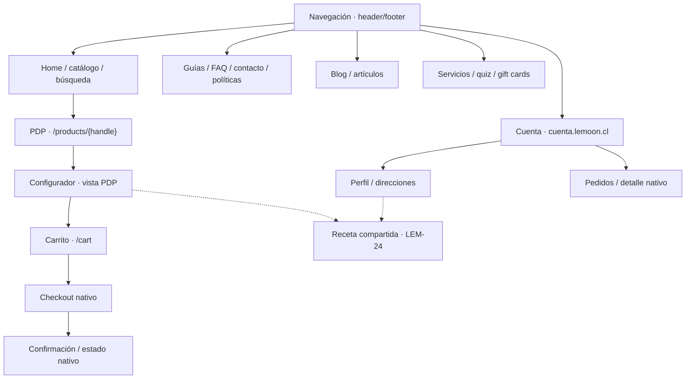

# Inventario de páginas y rutas — LEM-86

Mapa para localizar destinos, templates y responsables de Lemoon. Actualizarlo cuando cambie una ruta, su template o su dueño. El alcance, las fases, los estados de entrega y los criterios de aceptación se mantienen en los tickets enlazados.

Las rutas proceden del inventario de Admin y la implementación local. Los templates locales no acreditan su asignación pública: comprobar el [manifiesto CMS](../content/page-template-assignments.json). `{handle}` e `{id}` son recursos variables; las superficies nativas o capacidades sin ruta propia se identifican sin inventar una URL.

## Matriz de superficies

| Superficie | Destino | Template local / superficie | Dueño |
| --- | --- | --- | --- |
| Home · entrada | `/` | `index.json` | [LEM-48](https://linear.app/antekera/issue/LEM-48) |
| Catálogo · explorar | `/collections/all` (destino de menú) | `collection.json` | [LEM-47](https://linear.app/antekera/issue/LEM-47) |
| Colecciones · segmentar | 13 rutas en tabla inferior | `collection.json` | [LEM-47](https://linear.app/antekera/issue/LEM-47) |
| PDP · elegir armazón/variante | `/products/{handle}` | `product.json`, `product.optica.json` | [LEM-46](https://linear.app/antekera/issue/LEM-46) |
| Búsqueda · resultados | `/search` | `search.json` | [LEM-45](https://linear.app/antekera/issue/LEM-45) |
| Configuración · compra reducida/completa | Vista local de PDP: `?variant={id}&view=configurador` | `product.configurador.json`; alternativa local `page.configurador-de-lentes.json` sin página CMS registrada | [LEM-23](https://linear.app/antekera/issue/LEM-23) |
| Selección de cristales · opciones compatibles | Paso dentro de la configuración; `/collections/cristales` es el destino histórico de menú | `lens-configurator.liquid` | [LEM-23](https://linear.app/antekera/issue/LEM-23), datos LEM-93 |
| Receta · aportar/gestionar | Capacidad compartida desde configurador y perfil; endpoint contractual | LEM-24 + recepción back office LEM-140 | [LEM-24](https://linear.app/antekera/issue/LEM-24), [LEM-140](https://linear.app/antekera/issue/LEM-140) |
| Receta en perfil · acceso posterior | Dentro de `https://cuenta.lemoon.cl/profile` | Cuenta nueva + integración LEM-24 | [LEM-138](https://linear.app/antekera/issue/LEM-138), [LEM-123](https://linear.app/antekera/issue/LEM-123) |
| Carrito · revisar líneas/cargos | `/cart` | `cart.json`, drawer | [LEM-98](https://linear.app/antekera/issue/LEM-98) |
| Checkout · envío/pago | Sesión nativa de Shopify | Checkout nativo | [LEM-120](https://linear.app/antekera/issue/LEM-120) |
| Confirmación/estado · seguimiento | Enlace nativo del pedido | Thank you / Order status | [LEM-121](https://linear.app/antekera/issue/LEM-121) |
| Correos · compra/recepción | Notificaciones; sin página independiente | Emisor e integración LEM-139 | [LEM-139](https://linear.app/antekera/issue/LEM-139) |
| Acceso · autenticación | `https://cuenta.lemoon.cl` | Cuentas nuevas nativas | [LEM-122](https://linear.app/antekera/issue/LEM-122) |
| Perfil/direcciones · datos | `https://cuenta.lemoon.cl/profile`; direcciones dentro de cuenta | Cuenta nueva nativa | [LEM-123](https://linear.app/antekera/issue/LEM-123) |
| Mis pedidos · historial | `https://cuenta.lemoon.cl/orders` | Cuenta nueva nativa | [LEM-124](https://linear.app/antekera/issue/LEM-124) |
| Detalle de pedido · líneas/estado | Destino nativo desde pedidos | Cuenta/estado nativo | [LEM-125](https://linear.app/antekera/issue/LEM-125) |
| Rostro · elegir | `/pages/elegir-lentes-segun-tu-rostro` | `page.guia-rostro.json` | [LEM-103](https://linear.app/antekera/issue/LEM-103) |
| Medidas · medir | `/pages/como-medir-tus-lentes` | `page.guia-medidas.json` | [LEM-105](https://linear.app/antekera/issue/LEM-105) |
| Probador · explicación | `/pages/como-usar-probador-virtual` | `page.guia-probador.json` | [LEM-104](https://linear.app/antekera/issue/LEM-104) |
| Enviar receta · texto/video | `/pages/como-enviar-prescripcion` | `page.guia-prescripcion.json` | [LEM-106](https://linear.app/antekera/issue/LEM-106) |
| Hacer pedido · explicación | `/pages/como-hacer-tu-pedido` | `page.guia-pedido.json` | [LEM-107](https://linear.app/antekera/issue/LEM-107) |
| Nosotros · identidad | `/pages/nosotros` | `page.nosotros.json` | [LEM-108](https://linear.app/antekera/issue/LEM-108) |
| Operativos · servicio | `/pages/operativos-oftalmologicos` | `page.operativos-oftalmologicos.json` | [LEM-111](https://linear.app/antekera/issue/LEM-111) |
| Isapres/Fonasa · orientación | `/pages/isapres-y-fonasa` | `page.isapres-y-fonasa.json` | [LEM-112](https://linear.app/antekera/issue/LEM-112) |
| FAQ · dudas | `/pages/preguntas-frecuentes` | `page.preguntas-frecuentes.json` | [LEM-116](https://linear.app/antekera/issue/LEM-116) |
| Contacto · canal/formulario | `/pages/contact` | `page.contact.json` | [LEM-117](https://linear.app/antekera/issue/LEM-117) |
| Envíos/devoluciones · condiciones | `/pages/envios-y-entregas` | `page.envios-y-entregas.json` | [LEM-114](https://linear.app/antekera/issue/LEM-114) |
| Reembolso · política | `/pages/politicas` | `page.politica-de-devoluciones.json` | [LEM-113](https://linear.app/antekera/issue/LEM-113) |
| Garantías · cobertura | `/pages/garantias` | `page.garantias.json` | [LEM-115](https://linear.app/antekera/issue/LEM-115) |
| Términos · compra | `/pages/terminos-y-condiciones` | `page.terminos-y-condiciones.json` | [LEM-119](https://linear.app/antekera/issue/LEM-119) |
| Privacidad · política/preferencias | [Policy nativa](https://checkout.shopify.com/76333711528/policies/40676294824.html?locale=es) | Policy nativa; `page.privacidad.json` es alternativa local | [LEM-118](https://linear.app/antekera/issue/LEM-118) |
| Blog · listado | `/blogs/news` | `blog.json`, `blog.editorial.json` | [LEM-109](https://linear.app/antekera/issue/LEM-109), [LEM-38](https://linear.app/antekera/issue/LEM-38) |
| Artículo · lectura | `/blogs/news/como-elegir-un-armazon-que-se-sienta-tuyo` (borrador) | `article.json`, `article.editorial.json` | [LEM-110](https://linear.app/antekera/issue/LEM-110), [LEM-38](https://linear.app/antekera/issue/LEM-38) |
| 404 · recuperación | Respuesta a URL inexistente | `404.json` | [LEM-126](https://linear.app/antekera/issue/LEM-126) |
| Contraseña · prelanzamiento | Protección nativa; activación no verificada | `password.json` | [LEM-127](https://linear.app/antekera/issue/LEM-127) |
| Página genérica · fallback | `/pages/{handle}`; sin destino nuevo | `page.json` | [LEM-128](https://linear.app/antekera/issue/LEM-128) |
| Modal tallas · medidas en PDP | Componente dentro de PDP | `snippets/lemoon-product-size-guide.liquid`, `lemoon-size-guide-content.liquid` | [LEM-129](https://linear.app/antekera/issue/LEM-129) |
| Quiz · estilo | `/pages/buscar-mi-estilo` | `page.buscar-mi-estilo.json` | [LEM-11](https://linear.app/antekera/issue/LEM-11) |
| Gift cards · compra/tarjeta emitida | Producto `tarjeta-de-regalo-lemoon` en borrador; URL de tarjeta no verificada | `page.gift-card.json`, `product.gift-card.json`, `gift_card.liquid` | [LEM-9](https://linear.app/antekera/issue/LEM-9) |
| Header/menús · acceso | Destinos de compra/cuenta/ayuda | `header-group.json`, header | [LEM-131](https://linear.app/antekera/issue/LEM-131) |
| Footer · soporte | Destinos de ayuda/políticas/editorial | `footer-group.json`, footer | [LEM-94](https://linear.app/antekera/issue/LEM-94) |

### Colecciones y destinos complementarios

Las 13 colecciones comparten `collection.json`; [LEM-47](https://linear.app/antekera/issue/LEM-47) mantiene categorías, reglas y URLs.

| Grupo | Rutas registradas | Uso |
| --- | --- | --- |
| Ópticos | `/collections/opticos`, `/collections/opticos-hombre`, `/collections/opticos-mujer`, `/collections/opticos-unisex`, `/collections/opticos-ninos` | Catálogo y segmentación óptica |
| Sol y accesorios | `/collections/lentes-de-sol`, `/collections/accesorios` | Catálogo solar y complementos |
| Selecciones | `/collections/mejor-vendidos`, `/collections/lo-nuevo`, `/collections/frontpage` | Selecciones de catálogo; `frontpage` no es otra home |
| Necesidades de uso | `/collections/de-lectura`, `/collections/para-pantallas` | Agrupaciones de catálogo; sin inferir tratamientos ni disponibilidad |
| Cristales | `/collections/cristales` | Destino de menú existente; LEM-23/47/94 coordinan su relación con la selección dentro del configurador |

| Caso | Destino y tratamiento | Dueño / base |
| --- | --- | --- |
| CMS Sol y Cristales | `/pages/lentes-de-sol` y `/pages/cristales` coexisten con colecciones homónimas. Sin entrada en los menús consultados; conservar inventario y revisar su función antes de cambiar enlaces. | LEM-47/23/94 · `page.json` como base local; asignación por verificar |
| Sistema de diseño | `/pages/sistema-de-diseno`, sin entrada en menús consultados; superficie interna adicional, fuera del recorrido de compra. | LEM-86/141 · `page.sistema-de-diseno.json`; conservar registro sin decidir publicación |
| Alias FAQ | `/pages/pre` → `/pages/preguntas-frecuentes` es el redirect registrado. | LEM-116/94 · conservar alias existente |
| Reembolso y quiz | `/pages/politicas` y `/pages/buscar-mi-estilo` son los handles existentes. No hay redirect registrado entre `/guia-estilo` y el quiz. | LEM-113/11/94 · no sustituir por URLs propuestas |
| Segmentos del header local | Enlaces como `/collections/opticos/negro`, `/collections/lentes-de-sol/mujer` o `/collections/cristales/lectura` no son registros de subcolecciones. | LEM-47/131 · verificar tags/filtros y destinos antes de tratarlos como categorías |

## Sitemap editable

Mapa de relaciones entre superficies; las conexiones no certifican navegación publicada. Las capacidades dentro del configurador/perfil y las superficies nativas no necesitan páginas independientes.

## Fuentes por responsabilidad

| Información | Fuente que se mantiene |
| --- | --- |
| Navegación de header/footer y redirecciones | [LEM-131](https://linear.app/antekera/issue/LEM-131), [LEM-94](https://linear.app/antekera/issue/LEM-94); matriz y alias de este documento |
| Pasos, saltos y compatibilidad del configurador | [LEM-23](https://linear.app/antekera/issue/LEM-23); datos de producto en [LEM-93](https://linear.app/antekera/issue/LEM-93) |
| Receta, acceso posterior y recepción | [LEM-24](https://linear.app/antekera/issue/LEM-24), entrada de perfil [LEM-138](https://linear.app/antekera/issue/LEM-138), recepción [LEM-140](https://linear.app/antekera/issue/LEM-140) |
| Correos de compra y recepción | [LEM-139](https://linear.app/antekera/issue/LEM-139) |
| Alcance y fases del producto | [LEM-56](https://linear.app/antekera/issue/LEM-56) y ticket dueño de cada fila |
| Reglas visuales y referencias Figma | Guía canónica de [LEM-141](https://linear.app/antekera/issue/LEM-141); componentes [LEM-132](https://linear.app/antekera/issue/LEM-132); diseño específico en cada ticket de página |
| Archivos de sección y composición | [Inventario de secciones](section-inventory.md), [plan de diseño](design-plan.md) |
| Integración de catálogo y PDP | [Setup PLP](../shopify-collection-plp-setup.md), [setup PDP](../shopify-eyewear-pdp-setup.md) |
