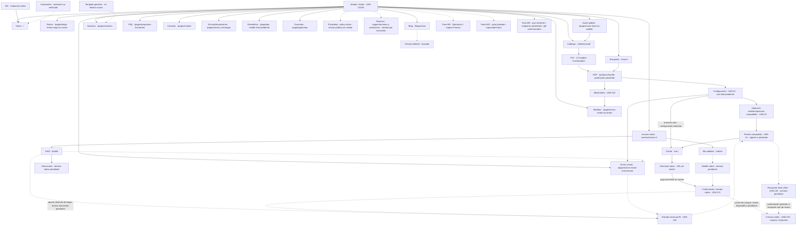

# Inventario vigente de páginas, sitemap y rutas — LEM-86

Fecha de consulta: **30-10-2026 UTC / 29-10-2026 Santiago**. Documento para revisión; **aprobación final de Miguel pendiente**. Base inspeccionada: `22a9856806a37c2cf965fd4dd9eaf867e107b482`, remoto `antekera/lemoon-shopify-theme`, rama `chore/lem-86-page-inventory`. No certifica publicación, integración ni QA del storefront.

## Fuentes, alcance y precedencia

1. Instrucción del lote LEM-141/LEM-86 y decisiones actuales de [LEM-56](https://linear.app/antekera/issue/LEM-56), [LEM-23](https://linear.app/antekera/issue/LEM-23) y [LEM-24](https://linear.app/antekera/issue/LEM-24): configuración reducida también para armazón solo, pago antes de receta, una receta vigente compartida con perfil y recepción real en back office. Prevalecen sobre las referencias históricas a receta post-MVP, compra directa sin configuración o WhatsApp como sustituto.
2. [LEM-86](https://linear.app/antekera/issue/LEM-86), descripción completa y comentarios live; [LEM-47](https://linear.app/antekera/issue/LEM-47) conserva arquitectura, categorías, filtros, URLs y fichas de aceptación; [LEM-93](https://linear.app/antekera/issue/LEM-93) conserva el contrato de producto. Este documento registra observaciones y destinos pendientes; no duplica esas decisiones ni sus checklists.
3. Shopify Admin, consultas de lectura completas de páginas, colecciones, menús, blogs, artículos y redirects; configuración de cuentas y políticas; inventario de handles/estado de productos. Ver los registros y límites en los apéndices. Identidad confirmada: `gid://shopify/Shop/76333711528`, dominio principal `https://lemoon.cl`, `myshopifyDomain=pzsrt4-1u.myshopify.com`. El alias `lemoon-8277.myshopify.com` de [theme-workflow](../../.claude/rules/theme-workflow.md) difiere: discrepancia registrada, sin reconfiguración.
4. [Figma Lemoon Ecommerce](https://www.figma.com/design/9EgE1vntKfwoQIQTzBUBNg/Lemoon-Ecommerce): metadata live de todas las páginas superiores y subárboles Cover, Flujo de compra de cristales, Page 4 y Page 6. Los dos últimos están vacíos. Foundations/Components y Footer se identificaron en el listado superior; la inspección del subárbol Footer devolvió límite de llamadas del plan Starter, por lo que su frame concreto queda pendiente. No hubo auditoría exhaustiva de estados internos de componentes. Los enlaces F abajo apuntan a frames reales; **existencia/nombre no significa aprobación visual**, elección entre variantes ni validación responsive. No se crearon archivos Figma.
5. Archivos locales en la base: [plan anterior](remaining-pages-plan.md), [inventario de secciones](section-inventory.md), [plan visual](design-plan.md), [marca](brand-guidelines.md), [asignaciones CMS propuestas](../content/page-template-assignments.json), [setup PLP](../shopify-collection-plp-setup.md) y [setup PDP](../shopify-eyewear-pdp-setup.md). Sus pruebas y previews de octubre son antecedentes; no se reejecutaron ni prueban el estado actual. LEM-141 consolida la guía visual por separado; este inventario no elige colores, fuentes o dirección visual.

Context7 resolvió Shopify pero `query-docs` devolvió cuota agotada. Se contrastaron [pages/paginación](https://shopify.dev/docs/api/admin-graphql/latest/queries/pages) y [CustomerAccountsV2](https://shopify.dev/docs/api/admin-graphql/latest/objects/CustomerAccountsV2) en documentación oficial, más introspección real antes de construir consultas. El validador del conector indicó que valida al ejecutar; las lecturas posteriores respondieron sin errores.

**Leyenda:** V = registro, handle, enlace de menú o configuración verificados en Admin; L = archivo/comportamiento inspeccionado localmente; P = decisión/destino/asignación pendiente. V no prueba que una URL renderice públicamente ni que tenga contenido aprobado. Las rutas con `{…}` describen patrones, no URLs navegables. En CMS, el sufijo live se conserva literal: `page`, vacío y `null` no se sustituyen por el sufijo propuesto; no se ha comprobado qué fallback aplica el tema publicado.

**Fases:** M3 = storefront funcional; M4 = adquisición/editorial; M9 = conversión futura; M10 = probador. Son fases de los tickets live, no orden nuevo ni autorización para adelantar capacidades. MVP crítico por decisión actual incluye LEM-23/24/138/139/140 aunque documentos viejos lo difieran. «Reutilizar» significa completar/verificar la base existente; «crear» identifica un faltante, no autoriza publicación; «diferir» conserva una fase futura explícita o registra una propuesta pendiente de Miguel.

## Referencias de diseño verificadas

| Código | Frames reales (desktop / mobile salvo indicación) | Uso y límite |
| --- | --- | --- |
| F-home | [60:2](https://www.figma.com/design/9EgE1vntKfwoQIQTzBUBNg/Lemoon-Ecommerce?node-id=60-2) / [63:362](https://www.figma.com/design/9EgE1vntKfwoQIQTzBUBNg/Lemoon-Ecommerce?node-id=63-362); Direction 02 [269:583](https://www.figma.com/design/9EgE1vntKfwoQIQTzBUBNg/Lemoon-Ecommerce?node-id=269-583) / [270:583](https://www.figma.com/design/9EgE1vntKfwoQIQTzBUBNg/Lemoon-Ecommerce?node-id=270-583) | Referencias home; selección final pendiente en LEM-133/Miguel. |
| F-plp | [62:146](https://www.figma.com/design/9EgE1vntKfwoQIQTzBUBNg/Lemoon-Ecommerce?node-id=62-146); Direction 02 [269:689](https://www.figma.com/design/9EgE1vntKfwoQIQTzBUBNg/Lemoon-Ecommerce?node-id=269-689) / [270:657](https://www.figma.com/design/9EgE1vntKfwoQIQTzBUBNg/Lemoon-Ecommerce?node-id=270-657) | PLP compartida; no un diseño aprobado por cada colección. LEM-135. |
| F-pdp | [62:346](https://www.figma.com/design/9EgE1vntKfwoQIQTzBUBNg/Lemoon-Ecommerce?node-id=62-346) / [63:448](https://www.figma.com/design/9EgE1vntKfwoQIQTzBUBNg/Lemoon-Ecommerce?node-id=63-448); Direction 02 [269:821](https://www.figma.com/design/9EgE1vntKfwoQIQTzBUBNg/Lemoon-Ecommerce?node-id=269-821) / [270:742](https://www.figma.com/design/9EgE1vntKfwoQIQTzBUBNg/Lemoon-Ecommerce?node-id=270-742) | Base PDP; LEM-134 decide estados/diseño final. |
| F-config | [412:979 — Propuesta refinada](https://www.figma.com/design/9EgE1vntKfwoQIQTzBUBNg/Lemoon-Ecommerce?node-id=412-979), página [111:583](https://www.figma.com/design/9EgE1vntKfwoQIQTzBUBNg/Lemoon-Ecommerce?node-id=111-583) | Referencia identificada por el usuario según plan local; metadata confirma existencia. IA/OCR, precios y capacidades de muestra no se consideran aprobados. Flujos antiguos Cover/402:979 no sustituyen las reglas actuales LEM-23/24. |
| F-cart | [64:586](https://www.figma.com/design/9EgE1vntKfwoQIQTzBUBNg/Lemoon-Ecommerce?node-id=64-586); Direction 02 [269:916](https://www.figma.com/design/9EgE1vntKfwoQIQTzBUBNg/Lemoon-Ecommerce?node-id=269-916) / [270:814](https://www.figma.com/design/9EgE1vntKfwoQIQTzBUBNg/Lemoon-Ecommerce?node-id=270-814) | Carrito; completar aprobación/estados LEM-136. |
| F-search | [274:674](https://www.figma.com/design/9EgE1vntKfwoQIQTzBUBNg/Lemoon-Ecommerce?node-id=274-674) / [275:665](https://www.figma.com/design/9EgE1vntKfwoQIQTzBUBNg/Lemoon-Ecommerce?node-id=275-665) | Búsqueda mantiene sus wireframes/estados en LEM-45. |
| F-blog | [274:583](https://www.figma.com/design/9EgE1vntKfwoQIQTzBUBNg/Lemoon-Ecommerce?node-id=274-583) / [275:583](https://www.figma.com/design/9EgE1vntKfwoQIQTzBUBNg/Lemoon-Ecommerce?node-id=275-583) | Listado editorial; LEM-109. |
| F-article | [274:649](https://www.figma.com/design/9EgE1vntKfwoQIQTzBUBNg/Lemoon-Ecommerce?node-id=274-649) / [275:634](https://www.figma.com/design/9EgE1vntKfwoQIQTzBUBNg/Lemoon-Ecommerce?node-id=275-634) | Artículo; LEM-110. |
| F-checkout | [274:732](https://www.figma.com/design/9EgE1vntKfwoQIQTzBUBNg/Lemoon-Ecommerce?node-id=274-732) / [275:706](https://www.figma.com/design/9EgE1vntKfwoQIQTzBUBNg/Lemoon-Ecommerce?node-id=275-706) | Referencia nativa; no prueba personalización habilitada o branding publicado. |
| F-status | [274:783](https://www.figma.com/design/9EgE1vntKfwoQIQTzBUBNg/Lemoon-Ecommerce?node-id=274-783) / [275:742](https://www.figma.com/design/9EgE1vntKfwoQIQTzBUBNg/Lemoon-Ecommerce?node-id=275-742) | Confirmación; detalle/estados reales por verificar en LEM-121/125. |

«Diseño faltante» abajo significa **frame específico no localizado/verificado**, no que se haya demostrado ausencia en cualquier archivo Figma. No se elimina el alcance visual histórico de soporte, cuentas o búsqueda: cada ticket conserva wireframes, estados y revisión propios. Componentes compartidos: LEM-132; prototipo navegable: LEM-137, todavía no acreditado por este mapa.

## Matriz de superficies

Los enlaces de ticket son la fuente de propósito, fase y aceptación; el apéndice CMS conserva ID, sufijo y publicación para cada handle. No se crean rutas nuevas para rellenar vacíos.

| Página / propósito | Ruta o handle y evidencia | Template local / superficie nativa | Fase y ticket dueño | Diseño existente / faltante | Crear / reutilizar / diferir y motivo |
| --- | --- | --- | --- | --- | --- |
| Home — entrada al catálogo | `/` V menú; render P | `index.json` L | M3, [LEM-48](https://linear.app/antekera/issue/LEM-48) | F-home; LEM-133 | Reutilizar; no rediseñar base existente, faltan aceptación/assets definitivos. |
| Catálogo general — todos los productos | `/collections/all` V menú, sin registro de colección propio | `collection.json` L; `list-collections.json` es otro template | M3, [LEM-47](https://linear.app/antekera/issue/LEM-47) | F-plp; LEM-135 | Reutilizar destino de catálogo; no crear directorio paralelo. |
| Colecciones / PLP — segmentar catálogo | 13 handles V, desglose abajo; publicación por canal P | `collection.json`; variantes carousel L sin asignación live | M3, [LEM-47](https://linear.app/antekera/issue/LEM-47) | F-plp compartida; aceptación por categoría P | Reutilizar; arquitectura, reglas y SEO permanecen en LEM-47. |
| PDP — elegir armazón/variante | `/products/{handle}` patrón; 60 registros V, `onlineStoreUrl=null` en todos | `product.json`, `product.optica.json` L; prototipo `optica` V | M3, [LEM-46](https://linear.app/antekera/issue/LEM-46) | F-pdp; LEM-134 | Reutilizar; registro ACTIVE no acredita publicación/compra. |
| Búsqueda — descubrir/recuperar resultados | `/search` V menú | `search.json` L | M3, [LEM-45](https://linear.app/antekera/issue/LEM-45) | F-search; estados propios por completar | Reutilizar; revisar vacío, errores, filtros y navegación. |
| Configuración — compra reducida/completa | L: PDP `?variant={id}&view=configurador`; `/pages/configurador-de-lentes` no existe en pages | `product.configurador.json`, `page.configurador-de-lentes.json` L | MVP crítico, [LEM-23](https://linear.app/antekera/issue/LEM-23) | F-config, estados/integración P | Reutilizar UI; crear/completar integración faltante. Ruta final P, no crear otra página por inferencia. |
| Selección de cristales — opciones compatibles | Paso de LEM-23; `/collections/cristales` V destino histórico; no destino final aprobado | `lens-configurator.liquid`; guía de colección local | MVP crítico, [LEM-23](https://linear.app/antekera/issue/LEM-23), datos LEM-93 | F-config; compatibilidades reales P | Reutilizar dentro del configurador; reconciliar colección/CTA en LEM-23/94. |
| Receta — captura, recepción y reemplazo | Ruta/endpoint P; entradas configurador y perfil | Capacidad compartida, contrato backend P; no página CMS autónoma verificada | MVP crítico, [LEM-24](https://linear.app/antekera/issue/LEM-24), servidor [LEM-140](https://linear.app/antekera/issue/LEM-140) | F-config referencia; estados compartidos P | Crear/completar capacidad integrada; una sola receta vigente, sin duplicar backend ni aceptar UI como recepción. |
| Receta desde perfil — entrada posterior al pago | Perfil V `/profile` en cuenta; entrada receta P | Cuenta nueva nativa + integración por acordar | MVP crítico, [LEM-138](https://linear.app/antekera/issue/LEM-138), perfil LEM-123 | Diseño específico faltante | Crear/completar entrada consumidora de LEM-24; conservar cuenta nativa. |
| Carrito — revisar compra y cargos | `/cart` L vía `routes.cart_url`, render P | `cart.json`, drawer L | M3, [LEM-98](https://linear.app/antekera/issue/LEM-98) | F-cart; LEM-136 | Reutilizar; preservar asociación de extras/armazón y receta pendiente. |
| Checkout — datos, envío y pago | URL de sesión nativa P; no ruta personalizada fijada | Checkout nativo; configuración/branding activo P | M3, [LEM-120](https://linear.app/antekera/issue/LEM-120) | F-checkout referencia | Reutilizar; invitado permitido según config, pago sin receta es requisito. |
| Confirmación y estado — compra/receta/despacho | Enlace nativo por pedido P, sin consultar pedidos reales | Thank you / Order status nativos | M3, [LEM-121](https://linear.app/antekera/issue/LEM-121) | F-status referencia | Reutilizar; no fabricar una URL pública ni confundir pago con receta recibida. |
| Acceso — autenticación | `https://cuenta.lemoon.cl` V raíz config; URL exacta de acceso P | `NEW_CUSTOMER_ACCOUNTS`; sin templates legacy locales | M3, [LEM-122](https://linear.app/antekera/issue/LEM-122) | Diseño específico faltante; nativo por revisar | Reutilizar; no crear login/registro paralelo. |
| Perfil y direcciones — datos personales | `https://cuenta.lemoon.cl/profile` V menú; subruta direcciones P | Cuenta nueva nativa | M3, [LEM-123](https://linear.app/antekera/issue/LEM-123) | Diseño específico faltante | Reutilizar nativo; URL/menu no prueban guardado ni aislamiento. |
| Mis pedidos — historial | `https://cuenta.lemoon.cl/orders` V menú | Cuenta nueva nativa | M3, [LEM-124](https://linear.app/antekera/issue/LEM-124) | Diseño específico faltante | Reutilizar; listado real y permisos P. |
| Detalle de pedido — líneas y estado | Destino nativo P, sin inventar `/orders/{id}` | Cuenta/estado nativo | M3, [LEM-125](https://linear.app/antekera/issue/LEM-125) | F-status solo referencia; detalle específico P | Reutilizar; validar con pedido sintético autorizado en entrega propia. |
| Rostro — guía de elección | `/pages/elegir-lentes-segun-tu-rostro` V | `page.guia-rostro.json` L; sufijo live null | M3, [LEM-103](https://linear.app/antekera/issue/LEM-103) | Diseño específico faltante | Reutilizar registro/guía; asignación final y texto/QA P. |
| Medidas — guía y diagrama | `/pages/como-medir-tus-lentes` V | `page.guia-medidas.json` L; sufijo live null | M3, [LEM-105](https://linear.app/antekera/issue/LEM-105) | Diseño específico faltante | Reutilizar; completar contenido y asignación, sin duplicar modal PDP. |
| Probador — explicación de capacidad real | `/pages/como-usar-probador-virtual` V | `page.guia-probador.json` L; sufijo live null | M10, [LEM-104](https://linear.app/antekera/issue/LEM-104) | Diseño específico faltante | Diferir habilitación del probador a su fase; reutilizar base explicativa, no prometer capacidad por tener enlace. |
| Enviar receta — explicación texto/video | `/pages/como-enviar-prescripcion` V | `page.guia-prescripcion.json` L; sufijo live null | M3, [LEM-106](https://linear.app/antekera/issue/LEM-106) | Diseño específico faltante; video final P | Reutilizar; explica LEM-24, no reemplaza captura/recepción ni privacidad. |
| Hacer pedido — explicación de compra | `/pages/como-hacer-tu-pedido` V | `page.guia-pedido.json` L; sufijo live null | M3, [LEM-107](https://linear.app/antekera/issue/LEM-107) | Diseño específico faltante | Reutilizar; alinear explicación con opciones y pago antes de receta. |
| Nosotros — identidad | `/pages/nosotros` V | `page.nosotros.json` L; sufijo live `page` | M3, [LEM-108](https://linear.app/antekera/issue/LEM-108) | Diseño específico faltante | Reutilizar registro y base editorial; no inferir aprobación desde historial. |
| Operativos — información/solicitud de servicio | `/pages/operativos-oftalmologicos` V | `page.operativos-oftalmologicos.json` L; sufijo null | M9, [LEM-111](https://linear.app/antekera/issue/LEM-111) | Diseño específico faltante | Diferir activación a fase prevista; reutilizar base sin inventar cobertura/reservas. |
| Isapres/Fonasa — orientación y convenios | `/pages/isapres-y-fonasa` V | `page.isapres-y-fonasa.json` L; sufijo null | M9, [LEM-112](https://linear.app/antekera/issue/LEM-112) | Diseño específico faltante | Diferir servicio a fase prevista; registro no confirma convenios. |
| FAQ — resolver dudas | `/pages/preguntas-frecuentes` V | `page.preguntas-frecuentes.json` L; sufijo `page` | M3, [LEM-116](https://linear.app/antekera/issue/LEM-116) | Diseño específico faltante; conservar wireframes del ticket | Reutilizar; preguntas/condiciones finales y asignación P. |
| Contacto — canal y formulario | `/pages/contact` V | `page.contact.json` L; sufijo `contact` V | M3, [LEM-117](https://linear.app/antekera/issue/LEM-117) | Diseño específico faltante | Reutilizar; asignación coincide, recepción/canales actuales P. |
| Envíos/devoluciones — condiciones | `/pages/envios-y-entregas` V | `page.envios-y-entregas.json` L; sufijo `page` | M3, [LEM-114](https://linear.app/antekera/issue/LEM-114) | Diseño específico faltante | Reutilizar shell/registro; no fijar tarifas/plazos sin negocio. |
| Reembolso — política | `/pages/po` V, handle definitivo P | `page.politica-de-devoluciones.json` L; sufijo `page` | M3, [LEM-113](https://linear.app/antekera/issue/LEM-113) | Diseño específico faltante | Reutilizar página actual; decidir handle/redirect en su ticket antes de cambiar enlaces. |
| Garantías — cobertura/exclusiones | `/pages/garantias` V | `page.garantias.json` L; sufijo null | M3, [LEM-115](https://linear.app/antekera/issue/LEM-115) | Diseño específico faltante | Reutilizar; texto/condiciones/asignación P. |
| Privacidad — política y preferencias | Política nativa V: ver URL exacta abajo; `/policies/privacy-policy` documentada localmente, render P | Policy nativa, shell `layout/theme.liquid`; `page.privacidad.json` solo alternativa local | M3, [LEM-118](https://linear.app/antekera/issue/LEM-118) | Diseño específico faltante | Reutilizar nativa; no crear CMS `/pages/privacidad` duplicado. |
| Términos — condiciones de compra | `/pages/terminos-y-condiciones` V | `page.terminos-y-condiciones.json` L; sufijo `page` | M3, [LEM-119](https://linear.app/antekera/issue/LEM-119) | Diseño específico faltante | Reutilizar; no asumir otra policy nativa existente. |
| Blog — listado editorial | `/blogs/news` V menú/Blog 99066118312 | `blog.json`, `blog.editorial.json` L; sufijo null V | M4, [LEM-109](https://linear.app/antekera/issue/LEM-109); selección [LEM-38](https://linear.app/antekera/issue/LEM-38) | F-blog | Reutilizar blog existente; no crear `/blog` paralelo. |
| Artículo — lectura | `/blogs/news/como-elegir-un-armazon-que-se-sienta-tuyo` patrón del registro V, **borrador no publicado** | `article.json`, `article.editorial.json` L; sufijo `editorial` V | M4, [LEM-110](https://linear.app/antekera/issue/LEM-110), LEM-38 | F-article | Reutilizar borrador, publicación/editorial P; enlace público no validado. |
| 404 — recuperación | Respuesta ante URL inexistente; URL de prueba P | `404.json` L | M3, [LEM-126](https://linear.app/antekera/issue/LEM-126) | Diseño específico faltante | Reutilizar; no tratar `/404` como página CMS ni dar HTTP correcto por probado. |
| Contraseña/lanzamiento — acceso previo | Superficie nativa de tienda protegida; estado habilitado y URL P | `password.json` L | M3, [LEM-127](https://linear.app/antekera/issue/LEM-127), pendiente de revisión | Diseño específico faltante | Reutilizar base; no activar/desactivar protección ni newsletter aquí. |
| Página genérica — contenido sin template propio | `/pages/{handle}` patrón; sin nueva página elegida | `page.json` L | M3, [LEM-128](https://linear.app/antekera/issue/LEM-128), pendiente de revisión | Diseño específico faltante | Reutilizar como fallback revisable, no duplicar Nosotros. |
| Modal tallas — medidas en PDP | Componente PDP, sin ruta independiente | `snippets/lemoon-product-size-guide.liquid` y `lemoon-size-guide-content.liquid` L | M3, [LEM-129](https://linear.app/antekera/issue/LEM-129), pendiente de revisión | F-pdp contextual; modal/estados específicos P | Reutilizar drawer/base real; `size-guide-diagram.liquid` del plan histórico no existe en esta base. Completar aceptación del modal. |
| Antiparras — categoría estacional | Handle P; no registro en 13 colecciones | PLP compartida si se aprueba | M9, [LEM-1](https://linear.app/antekera/issue/LEM-1), evaluar temporada 2027 | F-plp genérica; diseño/catálogo propio P | Diferir; no crear handle ni activar por aparecer aquí. |
| Quiz — recomendación de estilo | `/pages/buscar-mi-estilo` V; `/guia-estilo` propuesta histórica | `page.buscar-mi-estilo.json` L; sufijo null V | M9 / POST-MVP, [LEM-11](https://linear.app/antekera/issue/LEM-11) | Diseño específico faltante según spec local | Reutilizar base en su fase; no adelantar por estar enlazado en menús. |
| Gift cards — compra y tarjeta emitida | `tarjeta-de-regalo-lemoon` V producto DRAFT, sufijo vacío; página de compra y URL de tarjeta P | `page.gift-card.json`, `product.gift-card.json`, `gift_card.liquid` L; son superficies distintas | M9, [LEM-9](https://linear.app/antekera/issue/LEM-9) | Diseño específico faltante | Diferir activación; reutilizar bases, no emitir ni probar una tarjeta real. |
| Header/menús — acceso compartido | 10 registros V; header local tiene enlaces/bloques propios | `header-group.json`, header L; asignación publicada P | M3, [LEM-131](https://linear.app/antekera/issue/LEM-131) | F-home/F-plp/F-pdp contextuales; estados LEM-132 | Reutilizar; jerarquía no exige rutas anidadas. |
| Footer — soporte y destinos | Menús `footer-*` V; grupos localmente referenciados | `footer-group.json`, footer L; publicación P | M3, [LEM-94](https://linear.app/antekera/issue/LEM-94) | Página Figma [329:583](https://www.figma.com/design/9EgE1vntKfwoQIQTzBUBNg/Lemoon-Ecommerce?node-id=329-583) verificada; frame concreto/elección P | Reutilizar; reconciliar políticas, fase, mobile y Cristales sin duplicar páginas. |

## Sitemap editable

Fuente directa: [este bloque Mermaid en Markdown](page-inventory.md#sitemap-editable). No requiere un archivo Figma ni otro diagrama externo. Flecha continua = relación de navegación/recorrido a conservar según registros o requisitos; **no acredita enlace renderizado**. Flecha punteada = dependencia/destino pendiente o fase futura. IDs S se corresponden con superficies de la matriz; los grupos no son propuestas de URL.

Las colecciones concretas están en el apéndice, incluidas las no enlazadas desde menús. Las páginas duplicadas e internas también se inventarían abajo, pero no se convierten en destinos nuevos del sitemap de compra. Los enlaces futuros representan cobertura por fase, no aprobación para mostrarlos en la navegación del MVP.

## Recorridos y responsabilidades

1. **Sin opciones adicionales / solo armazón:** home, búsqueda o PLP → PDP/variante → configuración reducida de LEM-23 → revisar selección e importe real → carrito → checkout nativo → confirmación. El plan anterior permitía saltar PDP→carrito; el requisito actual exige la configuración aplicable, aunque no haya pantallas adicionales. No exigir receta para opciones que no la necesitan.
2. **Con opciones compatibles:** PDP → configuración → uso/graduación y cristales, grosor/extras que realmente ofrezca Shopify → revisión → carrito → checkout → confirmación. El orden detallado y saltos se resuelven en LEM-23 contra F-config y LEM-93; no se deducen del nombre de un metacampo ni se añaden cargos como simples textos. Volver/cambiar variante conserva o revalida compatibilidad, stock, asociaciones y total. No se crean aquí reglas clínicas ni precios.
3. **Con receta disponible:** configurador consume LEM-24 y permite usar la única vigente o aportar/reemplazar según contrato → recepción confirmada → seguir compra. Perfil consume exactamente la misma capacidad vía LEM-138; LEM-123 conserva datos/direcciones. Reemplazar solo después de recepción exitosa; ante error se mantiene la anterior. Los pedidos históricos conservan la fórmula asociada y no se reescriben al cambiar la vigente.
4. **Pagar antes de aportar receta:** elegir opciones compatibles → receta pendiente → carrito → pago → confirmación de compra y correo de compra LEM-139 con estado de receta pendiente → acceso posterior autorizado desde perfil/LEM-138 o mecanismo de invitado por acordar → LEM-24 → recepción en LEM-140 → confirmación posterior por correo LEM-139 con la información realmente recibida. El requisito está confirmado; la autenticación/asociación del invitado sigue siendo un gap del contrato, no una URL pública de pedido inventada. El pago no espera la receta. Recibida no significa aprobada clínicamente ni enviada a fabricación.
5. **Ayuda:** configurador/perfil → LEM-106 explica envío de receta (texto/video final y alternativa accesible); LEM-107 explica cómo comprar y regresa al catálogo; FAQ/contacto/políticas permanecen accesibles desde navegación de ayuda. Las páginas explicativas no almacenan otra receta ni sustituyen la integración por WhatsApp. Medidas es guía general; el modal de tallas es un componente PDP, no otra página.

Con receta disponible o pendiente, pago/confirmación S11 requiere el correo de compra de LEM-139 con producto/armazón, características del lente y fórmula disponible o indicación de receta pendiente cuando corresponda. Ese correo no depende de recibir la receta pendiente: la recepción real S18 requiere una confirmación posterior con la información recibida. LEM-139 es el dueño único de ambos correos; no se define otro emisor.

Estos son recorridos requeridos, no pruebas ejecutadas. Contrato servidor/autenticación/recepción de LEM-140, datos LEM-93, notificaciones LEM-139 y entradas LEM-138 se validan en sus tickets. Este lote no inspeccionó datos de clientes, pedidos ni archivos clínicos.

## Discrepancias, huérfanas y decisiones pendientes

| Hallazgo verificado / límite | Acción para revisión, dueño y pregunta concreta |
| --- | --- |
| 18 páginas Admin publicadas; solo Contact tiene el sufijo específico que coincide con la propuesta local. Seis sufijos literales `page` y once null. | LEM-103–119/11/128: revisar asignación y fallback real antes de afirmar que el template local sirve la página. ¿Se aprueban las asignaciones por página del manifiesto existente? No aplicadas aquí. |
| `/pages/lentes-de-sol` y `/pages/cristales` existen, sin entradas en los 10 menús; hay colecciones homónimas enlazadas. | Candidatas a duplicación/huérfanas de menú, no huérfanas públicas demostradas. LEM-47/23/94: ¿conservar, desindexar o redirigir las páginas legacy? No se elige destino ni se borra contenido. |
| `/pages/sistema-de-diseno` existe y está publicada según Admin, sin entrada en menús. | Superficie interna adicional, template local `page.sistema-de-diseno.json`, live `page`. Propiedad pública por confirmar con LEM-86/141/Miguel. Propuesta: diferir su inclusión en navegación pública; no presupone despublicar ni que LEM-141 deba implementarla. |
| `/pages/terminos-y-condiciones` no figura en los menús consultados. Privacidad solo aparece como policy Admin; puede renderizarse desde lógica del footer. | LEM-119/118/94: confirmar entradas efectivas desktop/mobile/checkout. No afirmar ausencia pública sin revisar el render. |
| `frontpage`, `de-lectura`, `para-pantallas`, `mejor-vendidos`, `lo-nuevo` no tienen entrada directa en menús Admin; los dos últimos sí están enlazados en header local. | LEM-47/131: distinguir colección usada en bloques/home/filtros de una landing huérfana; inspeccionar tema publicado. No eliminar colecciones por no estar en un menú. |
| Header local contiene `/collections/opticos/negro` y otros colores, `/collections/lentes-de-sol/mujer`, `hombre`, `mas-vendidos`, `nueva-coleccion`, colores y `/collections/cristales/lectura`, `pantallas`, `monofocal`. No hay colecciones con esos handles compuestos. | Son posibles rutas por tags/segmentación, no subcolecciones verificadas ni 404 demostrados. LEM-47/131: confirmar semántica, tags y filtros/canonical; ¿qué destinos se conservan según catálogo real? Jerarquía no obliga a anidar rutas. |
| `/pages/po` sigue enlazada en servicios/cuentas; solo existe redirect `/pages/pre` → `/pages/preguntas-frecuentes` (ID 608618119336). No hay redirect de `po` en el inventario completo. | LEM-113/94: confirmar handle final antes de preparar redirect `po`→destino aprobado. Mantener `pre` como alias existente; no inventar `/pages/politica-de-devoluciones` publicado. |
| `/guia-estilo` es propuesta histórica de LEM-11; Admin y menús usan `/pages/buscar-mi-estilo`; no redirect entre ellos. | LEM-11: registrar URL real en su aceptación; redirección solo si se confirma uso previo de la propuesta, sin crear alias por rellenar el mapa. |
| Cristales tiene colección y página CMS; no existe página CMS configurador. El enlace local usa la vista de producto. | LEM-23/94: ¿qué destino final debe usar Cristales y qué conserva la colección editorial? Selección de cristales pertenece a LEM-23, no se abre otra implementación. |
| Cuenta nueva habilitada y opcional, raíz y destinos profile/orders verificados; rutas internas, branding activo, detalle de pedido y receta no verificados. | LEM-120–125/138/140: validar mediante entorno autorizado; acordar carga posterior para invitado. No inventar login, direcciones ni detalle desde templates legacy. |
| Menús incluyen servicios futuros, guía de probador y quiz; existencia no cambia M9/M10/POST-MVP. | LEM-94/131 y tickets dueños: revisar visibilidad por fase sin activar capacidades. ¿Qué enlaces aprobados deben mostrarse al lanzamiento? |
| Menús `customer-account-main-menu` y `lemoon-cuentas-y-ayuda-revisi-n` comparten orders/profile; footer repite servicios/ayuda por viewport. | Duplicación de enlaces no prueba duplicación de implementación. LEM-94/121/123/131: comprobar menú activo y paridad mobile; el sufijo «revisión» no acredita asignación publicada. |
| 60 productos, todos `onlineStoreUrl=null`; 58 ACTIVE, un UNLISTED prototipo, una tarjeta DRAFT. Único artículo en borrador. | LEM-46/47/70/9/110: validar publicación/catálogo/preview por separado. No convertir muestras, precios o stock en promesas comerciales. |

**Resultado del diagnóstico:** cobertura documental completa del mínimo de LEM-86 y de los registros consultados, con candidatos concretos a huérfanas/duplicación/redirect. No hay evidencia suficiente para afirmar que el sitio publicado carece de huérfanas o duplicados: faltan recorrido renderizado, enlaces en contenido, tema activo, canales y confirmación de las decisiones anteriores. Los faltantes quedan en sus tickets dueños; no se corrige publicación desde este documento.

## Validación y revisión

- Diff exclusivamente documental en este archivo; sin cambios de tema ejecutable, locales, settings o aplicaciones externas. Sin commit/push/PR en esta etapa.
- Paginación completa en cada conexión listada en los apéndices: `hasNextPage=false`. Menús: árbol leído hasta hojas, sin hijos truncados observados. Registro de menú no equivale a asignación del menú al tema activo.
- Enlaces relativos de archivos, correspondencia de handles/sufijos/IDs y cobertura de tickets revisados contra consultas live/base. Frames enlazados verificados por metadata; no revisión visual ni aprobación de todas las variantes.
- Tests runtime (Vitest, Playwright) y preview de storefront: **N/A para este diff documental**; no cambió comportamiento renderizado. No se ejecutó `theme dev` ni se hizo sincronización con Shopify. No se registraron casos de integración como aprobados.
- Theme Check: ejecución posterior del tester separado, reportada al coordinador con `shopify theme check --fail-level error`: **252 archivos, 0 infracciones, exit 0**. Es evidencia del checker del tema, no de runtime ni de integración; el autor corrector no ejecutó este check ni se atribuye su resultado.
- La [planilla única de QA](https://docs.google.com/spreadsheets/d/1-9lFVbk4erK1CuuN8-dLEuxduo4pVDHMWSYHN05sJvE/edit#gid=979175146) sigue siendo la fuente de ejecuciones; se referencia desde tickets, no se duplican resultados ni se afirma haberla revalidado en este trabajo.
- Revisión independiente de fuentes/convenciones: pendiente del coordinador; no se afirma aislamiento técnico de permisos. Revisión y aprobación de Miguel: **pendiente**, con preguntas anteriores para resolver en sus tickets. LEM-86 continúa In Progress; este inventario no cierra los diseños LEM-132–137 ni aprueba páginas para producción.

## Apéndices de consulta Shopify

Snapshot de lectura; IDs numéricos corresponden al tipo indicado (`gid://shopify/Page/…`, `Collection/…`, `Menu/…`). Las rutas CMS/colección se expresan desde handles observados; no se siguieron como pruebas HTTP. Estado de publicación CMS es exclusivamente el devuelto por Admin.

### Páginas CMS — 18 registros, conexión completa

| ID Page | Ruta derivada del handle V | Sufijo live literal | isPublished / publishedAt UTC |
| --- | --- | --- | --- |
| 121882443944 | `/pages/contact` | `contact` | true / 2026-08-13T16:34:14Z |
| 122118471848 | `/pages/sistema-de-diseno` | `page` | true / 2026-08-22T20:31:43Z |
| 122118996136 | `/pages/terminos-y-condiciones` | `page` | true / 2026-08-22T21:22:49Z |
| 122119028904 | `/pages/po` | `page` | true / 2026-08-22T21:24:17Z |
| 122119061672 | `/pages/envios-y-entregas` | `page` | true / 2026-08-22T21:24:24Z |
| 122119094440 | `/pages/preguntas-frecuentes` | `page` | true / 2026-08-22T21:24:33Z |
| 161787576488 | `/pages/buscar-mi-estilo` | `null` | true / 2026-10-03T23:26:58Z |
| 161800257704 | `/pages/nosotros` | `page` | true / 2026-10-04T12:49:32Z |
| 161802879144 | `/pages/lentes-de-sol` | `null` | true / 2026-10-04T15:06:26Z |
| 161802911912 | `/pages/cristales` | `null` | true / 2026-10-04T15:06:34Z |
| 161807138984 | `/pages/elegir-lentes-segun-tu-rostro` | `null` | true / 2026-10-04T19:26:40Z |
| 161807171752 | `/pages/como-usar-probador-virtual` | `null` | true / 2026-10-04T19:26:40Z |
| 161807204520 | `/pages/como-medir-tus-lentes` | `null` | true / 2026-10-04T19:26:40Z |
| 161807237288 | `/pages/como-enviar-prescripcion` | `null` | true / 2026-10-04T19:26:40Z |
| 161807270056 | `/pages/como-hacer-tu-pedido` | `null` | true / 2026-10-04T19:26:40Z |
| 161807302824 | `/pages/isapres-y-fonasa` | `null` | true / 2026-10-04T19:26:41Z |
| 161807335592 | `/pages/garantias` | `null` | true / 2026-10-04T19:26:41Z |
| 161807401128 | `/pages/operativos-oftalmologicos` | `null` | true / 2026-10-04T19:27:02Z |

Los 18 registros quedan cubiertos por la matriz o por los tres casos adicionales (sistema de diseño, Sol CMS y Cristales CMS). La cobertura de registro no implica que se deban mantener los tres en navegación pública.

### Colecciones — 13 registros, conexión completa

Todas tienen `templateSuffix=null` V. Publicación por canal, reglas, productos y aceptación individual **no auditados aquí**; la plantilla compartida local es `templates/collection.json`, referencia F-plp. LEM-47 es dueño de las fichas; no se copian ni se aprueban reglas/SEO desde esta tabla. Las decisiones de reutilización abajo son propuestas de inventario para revisión, sin diferir una categoría existente por cuenta del agente.

| ID Collection | Ruta derivada V | Propósito del inventario | Fase / dueño / diseño | Acción y motivo |
| --- | --- | --- | --- | --- |
| 348896231592 | `/collections/frontpage` | Selección histórica de home; no equivale a la home / | M3 / LEM-47 / F-plp | Reutilizar solo si su uso en home se confirma; no crear segunda home |
| 349510009000 | `/collections/opticos` | Catálogo óptico | M3 / LEM-47 / F-plp | Reutilizar PLP y registro; completar ficha/QA en LEM-47 |
| 349510074536 | `/collections/opticos-hombre` | Segmentación ópticos hombre | M3 / LEM-47 / F-plp | Reutilizar PLP y registro; completar ficha/QA en LEM-47 |
| 349510107304 | `/collections/opticos-mujer` | Segmentación ópticos mujer | M3 / LEM-47 / F-plp | Reutilizar PLP y registro; completar ficha/QA en LEM-47 |
| 349510140072 | `/collections/opticos-unisex` | Segmentación ópticos unisex | M3 / LEM-47 / F-plp | Reutilizar PLP y registro; completar ficha/QA en LEM-47 |
| 349510172840 | `/collections/accesorios` | Complementos del armazón | M3 / LEM-47 / F-plp | Reutilizar PLP y registro; completar ficha/QA en LEM-47 |
| 349510238376 | `/collections/opticos-ninos` | Catálogo infantil; catálogo/edad por validar | M3 / LEM-47 / F-plp | Reutilizar PLP y registro; completar ficha/QA en LEM-47 |
| 349510271144 | `/collections/mejor-vendidos` | Selección por ventas a verificar | M3 / LEM-47 / F-plp | Reutilizar PLP y registro; completar ficha/QA en LEM-47 |
| 349510303912 | `/collections/lo-nuevo` | Novedades a verificar | M3 / LEM-47 / F-plp | Reutilizar PLP y registro; completar ficha/QA en LEM-47 |
| 349510336680 | `/collections/de-lectura` | Necesidad de lectura; disponibilidad por verificar | M3 / LEM-47 / F-plp | Reutilizar PLP y registro; completar ficha/QA en LEM-47 |
| 349510369448 | `/collections/para-pantallas` | Uso para pantallas; no promete tratamiento | M3 / LEM-47 / F-plp | Reutilizar PLP y registro; completar ficha/QA en LEM-47 |
| 512083132584 | `/collections/lentes-de-sol` | Catálogo solar | M3 / LEM-47 / F-plp | Reutilizar PLP y registro; completar ficha/QA en LEM-47 |
| 512083165352 | `/collections/cristales` | Destino histórico de cristales, reconciliar con configurador | MVP crítico / LEM-23 y LEM-47 / F-config y F-plp | Reutilizar registro mientras LEM-23/94 resuelven destino; no exige venta independiente |

`/collections/all` aparece en menús y LEM-47 como catálogo general, sin un registro propio en esta conexión. El template `list-collections.json` no autoriza otro directorio. Antiparras no figura entre los registros; no se asigna handle.

### Menús — 10 registros, conexión completa

Destinos guardados en Admin, no render/asignación publicada. Los hijos se muestran bajo su padre; en la consulta no hubo hojas con hijos sin explorar. La configuración local de header contiene además bloques con enlaces y no queda descrita solo por `main-menu`.

| ID Menu / handle V | Destinos guardados (jerarquía) |
| --- | --- |
| 246724100264 / `main-menu` | `/`; `/collections/opticos`; hijo: `/collections/opticos-hombre`; hijo: `/collections/opticos-mujer`; hijo: `/collections/opticos-unisex`; hijo: `/collections/opticos-ninos`; `/pages/contact`; `/collections/accesorios` |
| 246724133032 / `footer` | `/search` |
| 246724165800 / `customer-account-main-menu` | `https://cuenta.lemoon.cl/orders`; `https://cuenta.lemoon.cl/profile` |
| 255880626344 / `footer-products` | `/collections/opticos`; `/collections/lentes-de-sol`; `/collections/cristales`; `/collections/all` |
| 255880659112 / `footer-how-to` | `/pages/buscar-mi-estilo`; `/pages/elegir-lentes-segun-tu-rostro`; `/pages/como-usar-probador-virtual`; `/pages/como-medir-tus-lentes`; `/pages/como-enviar-prescripcion`; `/pages/como-hacer-tu-pedido` |
| 255880691880 / `footer-services` | `/pages/nosotros`; `/blogs/news`; `/pages/operativos-oftalmologicos`; `/pages/isapres-y-fonasa`; `/pages/po` |
| 255880724648 / `footer-services-mobile` | `/pages/operativos-oftalmologicos`; `/pages/isapres-y-fonasa`; `/pages/po` |
| 255880757416 / `footer-information` | `/pages/envios-y-entregas`; `/pages/garantias`; `/pages/preguntas-frecuentes`; `/pages/contact` |
| 255880790184 / `footer-quick-links` | `/pages/envios-y-entregas`; `/pages/garantias` |
| 256205521064 / `lemoon-cuentas-y-ayuda-revisi-n` | `https://cuenta.lemoon.cl/orders`; `https://cuenta.lemoon.cl/profile`; `https://lemoon.cl/pages/contact`; `https://lemoon.cl/pages/po`; `https://lemoon.cl/pages/garantias` |

### Cuentas y políticas — configuración V

- `customerAccounts=OPTIONAL`; `customerAccountsVersion=NEW_CUSTOMER_ACCOUNTS`.
- `loginRequiredAtCheckout=false`, `loginLinksVisibleOnStorefrontAndCheckout=true`; raíz devuelta: `https://cuenta.lemoon.cl`.
- Perfil y pedidos son destinos de menú de tipo `CUSTOMER_ACCOUNT_PAGE`: IDs `98671820968` y `98671788200`. La configuración no expone por sí sola la UI de direcciones, detalle ni receta.
- Única policy devuelta: `PRIVACY_POLICY`, ID `40676294824`, [URL exacta devuelta por Admin](https://checkout.shopify.com/76333711528/policies/40676294824.html?locale=es). No se consultó ni se reescribió su cuerpo; existencia no acredita texto definitivo.
- No se hallaron otras políticas nativas en `shopPolicies`; las políticas CMS existentes permanecen inventariadas sin migrarlas.

### Blog, artículo y redirect — conexiones completas

| Tipo / ID | Handle o ruta V | Template / estado |
| --- | --- | --- |
| Blog 99066118312 | `/blogs/news` | suffix null; render público P |
| Article 634930987176 | `/blogs/news/como-elegir-un-armazon-que-se-sienta-tuyo` | suffix `editorial`; isPublished=false |
| UrlRedirect 608618119336 | `/pages/pre` → `/pages/preguntas-frecuentes` | Registro existente; salto HTTP no probado |

### Productos — cobertura del patrón PDP

Consulta completa de 60 registros (`hasNextPage=false`), sin variantes/precios ni datos de clientes: 58 ACTIVE, uno UNLISTED y uno DRAFT; `onlineStoreUrl=null` para todos. `templateSuffix=null` en 58, `optica` en el prototipo UNLISTED `lemoon-dalton-prototipo` (15409107763368), vacío en `tarjeta-de-regalo-lemoon` DRAFT (15417003245736).

La muestra de búsqueda inicial (5 productos, `hasNextPage=true`) se amplió mediante consulta GraphQL de inventario de metadatos completo; no se presenta esa muestra como catálogo completo. Ejemplo de handle existente: `lemoon-artico` (9581567869096); `/products/lemoon-artico` es ruta derivada, no publicación comprobada. Muchos handles contienen «muestra» o «prototipo»; no se toma su contenido como catálogo comercial definitivo. No se enumeran 60 páginas editoriales nuevas ni se deduce disponibilidad de compra del estado ACTIVE.

### Resumen de cobertura y límites

| Consulta | Registros | Paginación / alcance |
| --- | --- | --- |
| `pages(first:100)` | 18 | hasNextPage=false |
| `collections(first:100)` | 13 | hasNextPage=false |
| `menus(first:100)` | 10 | hasNextPage=false |
| `blogs(first:100)` | 1 | hasNextPage=false |
| `articles(first:100)` | 1 | hasNextPage=false |
| `urlRedirects(first:100)` | 1 | hasNextPage=false |
| `products(first:100)` | 60 | hasNextPage=false |
| `shop` | Una tienda, una policy y configuración de cuentas | Campos individuales/lista no paginada; sin datos de clientes |

Quedan fuera de esta comprobación: canales de publicación de colecciones, configuración/tema publicado, password activo, sesiones checkout/cuentas, enlaces dentro de cada contenido CMS, SEO/indexabilidad, render responsive y recepción real de formularios/recetas/correos. Son gaps explícitos de validación, no ausencia demostrada.
