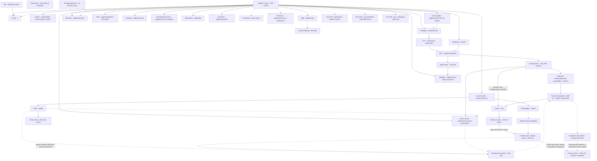

# Inventario de páginas, navegación y rutas — LEM-86

## Propósito y alcance

Mapa de superficies y destinos de Lemoon para implementar la navegación y los recorridos de compra de [LEM-86](https://linear.app/antekera/issue/LEM-86). [LEM-47](https://linear.app/antekera/issue/LEM-47) mantiene categorías, reglas y URLs de colecciones; [LEM-93](https://linear.app/antekera/issue/LEM-93) mantiene los datos de producto. Las decisiones de [LEM-56](https://linear.app/antekera/issue/LEM-56), LEM-23 y LEM-24 incluyen configuración, receta, entrada desde perfil y correos dentro del MVP.

Las rutas CMS y colecciones proceden de handles registrados en Admin; los destinos de cuenta y navegación, de su configuración. `/cart` y la vista del configurador corresponden a la implementación local. Los patrones `{handle}` y `{id}` representan recursos variables. Esta evidencia identifica destinos; no certifica render público, publicación comercial, integración ni ausencia de páginas huérfanas. Las capacidades sin URL verificada se sitúan dentro de su superficie o contrato.

Los templates de la matriz existen localmente; su presencia no confirma asignación en el tema publicado. Contacto tiene sufijo `contact`; las demás páginas CMS tienen `page` o `null` y requieren comprobar asignación/fallback contra el [manifiesto CMS](../content/page-template-assignments.json).

## Arquitectura de navegación

- **Compra:** home, catálogo y colecciones → PDP → configuración aplicable → carrito → checkout y confirmación nativos. La selección de cristales forma parte del configurador.
- **Cuenta:** acceso en `https://cuenta.lemoon.cl` → perfil/direcciones y pedidos/detalle. La receta se comparte entre configurador y perfil.
- **Ayuda y confianza:** guías de rostro, medidas, receta y compra; FAQ, contacto, Nosotros y políticas. Header y footer comparten destinos con paridad desktop/mobile bajo LEM-131/94.
- **Editorial:** blog y artículos, fase M4. Servicios, quiz y gift cards conservan M9; probador, M10. Su presencia en un menú no habilita la capacidad en el MVP.

La jerarquía del menú no exige URLs anidadas. Se reutilizan las bases existentes; «completar» identifica contenido, estados o integración del ticket dueño, sin aprobar publicación.

## Matriz de superficies

M3 corresponde al storefront funcional; M4, editorial/adquisición; M9/M10, ampliaciones futuras. Las filas MVP de configuración, receta, perfil y correos prevalecen sobre planes históricos que las diferían. En Diseño, F identifica una referencia verificada enlazada al final; un ticket sin referencia F conserva la entrega de wireframes y estados específicos aún por documentar.

| Superficie / propósito | Destino | Template local / superficie | Fase · dueño | Diseño | Tratamiento y motivo |
| --- | --- | --- | --- | --- | --- |
| Home · entrada | `/` | `index.json` | M3 · [LEM-48](https://linear.app/antekera/issue/LEM-48) | F-home | Reutilizar base; completar assets y aceptación. |
| Catálogo · explorar | `/collections/all` (destino de menú) | `collection.json` | M3 · [LEM-47](https://linear.app/antekera/issue/LEM-47) | F-plp | Reutilizar catálogo; no crear directorio paralelo. |
| Colecciones · segmentar | 13 rutas en tabla inferior | `collection.json` | M3 · [LEM-47](https://linear.app/antekera/issue/LEM-47) | F-plp | Reutilizar PLP; reglas/SEO por categoría en LEM-47. |
| PDP · elegir armazón/variante | `/products/{handle}` | `product.json`, `product.optica.json` | M3 · [LEM-46](https://linear.app/antekera/issue/LEM-46) | F-pdp | Reutilizar; publicación comercial por verificar. |
| Búsqueda · resultados | `/search` | `search.json` | M3 · [LEM-45](https://linear.app/antekera/issue/LEM-45) | F-search | Reutilizar; completar vacío, errores, filtros y navegación. |
| Configuración · compra reducida/completa | Vista local de PDP: `?variant={id}&view=configurador` | `product.configurador.json`; alternativa local `page.configurador-de-lentes.json` sin página CMS registrada | MVP · [LEM-23](https://linear.app/antekera/issue/LEM-23) | F-config | Reutilizar UI y completar integración; selección de cristales dentro de este flujo. |
| Selección de cristales · opciones compatibles | Paso dentro de la configuración; `/collections/cristales` es el destino histórico de menú | `lens-configurator.liquid` | MVP · [LEM-23](https://linear.app/antekera/issue/LEM-23), datos LEM-93 | F-config | Reutilizar dentro del configurador; coordinar acceso desde catálogo con LEM-47/94. |
| Receta · aportar/gestionar | Capacidad compartida desde configurador y perfil; endpoint contractual | LEM-24 + recepción back office LEM-140 | MVP · [LEM-24](https://linear.app/antekera/issue/LEM-24), [LEM-140](https://linear.app/antekera/issue/LEM-140) | F-config; estados compartidos por completar | Completar recepción y reemplazo seguro de una receta vigente. |
| Receta en perfil · acceso posterior | Dentro de `https://cuenta.lemoon.cl/profile` | Cuenta nueva + integración LEM-24 | MVP · [LEM-138](https://linear.app/antekera/issue/LEM-138), [LEM-123](https://linear.app/antekera/issue/LEM-123) | LEM-138 | Completar entrada a la misma capacidad de receta. |
| Carrito · revisar líneas/cargos | `/cart` | `cart.json`, drawer | M3 · [LEM-98](https://linear.app/antekera/issue/LEM-98) | F-cart | Reutilizar; conservar asociaciones y receta pendiente. |
| Checkout · envío/pago | Sesión nativa de Shopify | Checkout nativo | M3 · [LEM-120](https://linear.app/antekera/issue/LEM-120) | F-checkout | Reutilizar; permite invitado y pago antes de receta. |
| Confirmación/estado · seguimiento | Enlace nativo del pedido | Thank you / Order status | M3 · [LEM-121](https://linear.app/antekera/issue/LEM-121) | F-status | Reutilizar; distinguir compra, receta y despacho. |
| Correos · compra/recepción | Notificaciones; sin página independiente | Emisor e integración LEM-139 | MVP · [LEM-139](https://linear.app/antekera/issue/LEM-139) | Contenido/estados en su ticket | Completar correo de compra y confirmación posterior de receta recibida. |
| Acceso · autenticación | `https://cuenta.lemoon.cl` | Cuentas nuevas nativas | M3 · [LEM-122](https://linear.app/antekera/issue/LEM-122) | LEM-122 | Reutilizar acceso nativo; cuenta opcional. |
| Perfil/direcciones · datos | `https://cuenta.lemoon.cl/profile`; direcciones dentro de cuenta | Cuenta nueva nativa | M3 · [LEM-123](https://linear.app/antekera/issue/LEM-123) | LEM-123 | Reutilizar superficie; completar estados/guardado. |
| Mis pedidos · historial | `https://cuenta.lemoon.cl/orders` | Cuenta nueva nativa | M3 · [LEM-124](https://linear.app/antekera/issue/LEM-124) | LEM-124 | Reutilizar listado; validar datos y permisos. |
| Detalle de pedido · líneas/estado | Destino nativo desde pedidos | Cuenta/estado nativo | M3 · [LEM-125](https://linear.app/antekera/issue/LEM-125) | F-status como referencia; detalle por localizar | Reutilizar detalle nativo; no fijar una ruta interna no verificada. |
| Rostro · elegir | `/pages/elegir-lentes-segun-tu-rostro` | `page.guia-rostro.json` | M3 · [LEM-103](https://linear.app/antekera/issue/LEM-103) | LEM-103 | Reutilizar base y completar guía y asignación. |
| Medidas · medir | `/pages/como-medir-tus-lentes` | `page.guia-medidas.json` | M3 · [LEM-105](https://linear.app/antekera/issue/LEM-105) | LEM-105 | Reutilizar base y completar guía/diagrama; complementa modal PDP. |
| Probador · explicación | `/pages/como-usar-probador-virtual` | `page.guia-probador.json` | M10 · [LEM-104](https://linear.app/antekera/issue/LEM-104) | LEM-104 | Reutilizar base; diferir habilitación del probador a M10. |
| Enviar receta · texto/video | `/pages/como-enviar-prescripcion` | `page.guia-prescripcion.json` | M3 · [LEM-106](https://linear.app/antekera/issue/LEM-106) | LEM-106 | Reutilizar base y completar explicación y alternativa accesible; captura en LEM-24. |
| Hacer pedido · explicación | `/pages/como-hacer-tu-pedido` | `page.guia-pedido.json` | M3 · [LEM-107](https://linear.app/antekera/issue/LEM-107) | LEM-107 | Reutilizar base y completar guía de opciones y pago antes de receta. |
| Nosotros · identidad | `/pages/nosotros` | `page.nosotros.json` | M3 · [LEM-108](https://linear.app/antekera/issue/LEM-108) | LEM-108 | Reutilizar base y completar contenido y asignación. |
| Operativos · servicio | `/pages/operativos-oftalmologicos` | `page.operativos-oftalmologicos.json` | M9 · [LEM-111](https://linear.app/antekera/issue/LEM-111) | LEM-111 | Reutilizar base; diferir activación a M9. |
| Isapres/Fonasa · orientación | `/pages/isapres-y-fonasa` | `page.isapres-y-fonasa.json` | M9 · [LEM-112](https://linear.app/antekera/issue/LEM-112) | LEM-112 | Reutilizar base; diferir servicio a M9 sin inferir convenios. |
| FAQ · dudas | `/pages/preguntas-frecuentes` | `page.preguntas-frecuentes.json` | M3 · [LEM-116](https://linear.app/antekera/issue/LEM-116) | LEM-116 | Reutilizar base y completar respuestas, estados y asignación. |
| Contacto · canal/formulario | `/pages/contact` | `page.contact.json` | M3 · [LEM-117](https://linear.app/antekera/issue/LEM-117) | LEM-117 | Reutilizar; validar recepción y canales. |
| Envíos/devoluciones · condiciones | `/pages/envios-y-entregas` | `page.envios-y-entregas.json` | M3 · [LEM-114](https://linear.app/antekera/issue/LEM-114) | LEM-114 | Reutilizar base y completar condiciones de negocio y asignación. |
| Reembolso · política | `/pages/po` | `page.politica-de-devoluciones.json` | M3 · [LEM-113](https://linear.app/antekera/issue/LEM-113) | LEM-113 | Reutilizar página y conservar destino actual; cambio de handle/redirect corresponde a LEM-113/94. |
| Garantías · cobertura | `/pages/garantias` | `page.garantias.json` | M3 · [LEM-115](https://linear.app/antekera/issue/LEM-115) | LEM-115 | Reutilizar base y completar condiciones y asignación. |
| Términos · compra | `/pages/terminos-y-condiciones` | `page.terminos-y-condiciones.json` | M3 · [LEM-119](https://linear.app/antekera/issue/LEM-119) | LEM-119 | Reutilizar base y completar contenido y entrada de navegación con LEM-94. |
| Privacidad · política/preferencias | [Policy nativa](https://checkout.shopify.com/76333711528/policies/40676294824.html?locale=es) | Policy nativa; `page.privacidad.json` es alternativa local | M3 · [LEM-118](https://linear.app/antekera/issue/LEM-118) | LEM-118 | Reutilizar policy; entrada pública por validar, sin duplicar CMS. |
| Blog · listado | `/blogs/news` | `blog.json`, `blog.editorial.json` | M4 · [LEM-109](https://linear.app/antekera/issue/LEM-109), [LEM-38](https://linear.app/antekera/issue/LEM-38) | F-blog | Reutilizar blog y completar selección editorial. |
| Artículo · lectura | `/blogs/news/como-elegir-un-armazon-que-se-sienta-tuyo` (borrador) | `article.json`, `article.editorial.json` | M4 · [LEM-110](https://linear.app/antekera/issue/LEM-110), [LEM-38](https://linear.app/antekera/issue/LEM-38) | F-article | Reutilizar borrador; publicación editorial por validar. |
| 404 · recuperación | Respuesta a URL inexistente | `404.json` | M3 · [LEM-126](https://linear.app/antekera/issue/LEM-126) | LEM-126 | Reutilizar; completar estado y retorno al catálogo. |
| Contraseña · prelanzamiento | Protección nativa; activación no verificada | `password.json` | M3 · [LEM-127](https://linear.app/antekera/issue/LEM-127) | LEM-127 | Reutilizar base; no activar protección desde este inventario. |
| Página genérica · fallback | `/pages/{handle}`; sin destino nuevo | `page.json` | M3 · [LEM-128](https://linear.app/antekera/issue/LEM-128) | LEM-128 | Reutilizar para contenido sin plantilla propia. |
| Modal tallas · medidas en PDP | Componente dentro de PDP | `snippets/lemoon-product-size-guide.liquid`, `lemoon-size-guide-content.liquid` | M3 · [LEM-129](https://linear.app/antekera/issue/LEM-129) | F-pdp; modal/estados por completar | Reutilizar base y enlazar guía de medidas. |
| Antiparras · categoría estacional | Sin handle registrado | PLP compartida | M9 · [LEM-1](https://linear.app/antekera/issue/LEM-1) | F-plp; específico por localizar | Diferir a su fase; requiere catálogo/destino propio. |
| Quiz · estilo | `/pages/buscar-mi-estilo` | `page.buscar-mi-estilo.json` | M9 / post-MVP · [LEM-11](https://linear.app/antekera/issue/LEM-11) | LEM-11 | Reutilizar base en su fase; `/guia-estilo` es propuesta histórica. |
| Gift cards · compra/tarjeta emitida | Producto `tarjeta-de-regalo-lemoon` en borrador; URL de tarjeta no verificada | `page.gift-card.json`, `product.gift-card.json`, `gift_card.liquid` | M9 · [LEM-9](https://linear.app/antekera/issue/LEM-9) | LEM-9 | Diferir activación; compra y tarjeta emitida son superficies distintas. |
| Header/menús · acceso | Destinos de compra/cuenta/ayuda | `header-group.json`, header | M3 · [LEM-131](https://linear.app/antekera/issue/LEM-131) | F-home/plp/pdp; componentes LEM-132 | Reutilizar; comprobar asignación y paridad mobile. |
| Footer · soporte | Destinos de ayuda/políticas/editorial | `footer-group.json`, footer | M3 · [LEM-94](https://linear.app/antekera/issue/LEM-94) | [Página Footer](https://www.figma.com/design/9EgE1vntKfwoQIQTzBUBNg/Lemoon-Ecommerce?node-id=329-583); frame específico por localizar | Reutilizar; reconciliar políticas, fases y Cristales. |

### Colecciones y destinos complementarios

Estas 13 colecciones comparten `collection.json`, F-plp y LEM-47; se reutiliza la PLP y se completa la ficha de cada categoría en ese ticket. La publicación por canal y las reglas comerciales requieren su propia validación.

| Grupo | Rutas registradas | Uso |
| --- | --- | --- |
| Ópticos | `/collections/opticos`, `/collections/opticos-hombre`, `/collections/opticos-mujer`, `/collections/opticos-unisex`, `/collections/opticos-ninos` | Catálogo y segmentación óptica |
| Sol y accesorios | `/collections/lentes-de-sol`, `/collections/accesorios` | Catálogo solar y complementos |
| Selecciones | `/collections/mejor-vendidos`, `/collections/lo-nuevo`, `/collections/frontpage` | Selecciones de catálogo; `frontpage` no es otra home |
| Necesidades de uso | `/collections/de-lectura`, `/collections/para-pantallas` | Agrupaciones de catálogo; sin inferir tratamientos ni disponibilidad |
| Cristales | `/collections/cristales` | Destino de menú existente; LEM-23/47/94 coordinan su relación con la selección dentro del configurador |

Los siguientes destinos conservan cobertura sin imponer redirecciones ni eliminación. La ausencia de un enlace en menús no demuestra que una página esté huérfana.

| Caso | Destino y tratamiento | Dueño / base |
| --- | --- | --- |
| CMS Sol y Cristales | `/pages/lentes-de-sol` y `/pages/cristales` coexisten con colecciones homónimas. Sin entrada en los menús consultados; conservar inventario y revisar su función antes de cambiar enlaces. | LEM-47/23/94 · `page.json` como base local; asignación por verificar |
| Sistema de diseño | `/pages/sistema-de-diseno`, sin entrada en menús consultados; superficie interna adicional, fuera del recorrido de compra. | LEM-86/141 · `page.sistema-de-diseno.json`; conservar registro sin decidir publicación |
| Alias FAQ | `/pages/pre` → `/pages/preguntas-frecuentes` es el redirect registrado. | LEM-116/94 · conservar alias existente |
| Reembolso y quiz | `/pages/po` y `/pages/buscar-mi-estilo` son los handles existentes. No hay redirect registrado desde `po` ni entre `/guia-estilo` y el quiz. | LEM-113/11/94 · no sustituir por URLs propuestas |
| Segmentos del header local | Enlaces como `/collections/opticos/negro`, `/collections/lentes-de-sol/mujer` o `/collections/cristales/lectura` no son registros de subcolecciones. | LEM-47/131 · verificar tags/filtros y destinos antes de tratarlos como categorías |

## Sitemap editable

Fuente: [este bloque Mermaid](page-inventory.md#sitemap-editable). Las flechas continuas expresan navegación o recorridos requeridos; las punteadas, integración contractual o superficies futuras. El diagrama no certifica enlaces renderizados. Los nodos sin ruta son capacidades dentro de otra superficie o destinos nativos, no propuestas de URL.

La cuenta opcional permite comprar como invitado. El acceso posterior del invitado para aportar receta depende del contrato de autenticación y asociación de LEM-24/140; el mapa no le asigna una URL. La navegación de servicios/probador/quiz conserva las fases indicadas, aunque existan enlaces guardados en Admin.

## Recorridos MVP

1. **Sin opciones adicionales / solo armazón:** home, búsqueda o PLP → PDP/variante → configuración reducida LEM-23 → revisión del importe real → carrito → checkout → confirmación. Se aplican las opciones que correspondan al producto, aunque no requieran pantallas adicionales ni receta.
2. **Con opciones:** PDP → configuración → selección compatible de cristales, graduación, grosor y extras realmente disponibles en Shopify → revisión → carrito → checkout → confirmación. LEM-23 define pasos y saltos con F-config y el modelo LEM-93; al volver o cambiar variante se conservan o revalidan compatibilidad, stock, asociaciones e importe. No se deducen precios ni reglas clínicas desde el diseño.
3. **Receta disponible o nueva:** configurador → capacidad compartida LEM-24 → usar la única receta vigente o aportar/reemplazar → recepción confirmada por LEM-140 → seguir compra. Perfil accede a la misma capacidad mediante LEM-138; LEM-123 conserva datos y direcciones. El reemplazo ocurre solo después de recepción exitosa; ante error se mantiene la anterior. Cada pedido histórico conserva su fórmula asociada.
4. **Pago antes de receta:** opciones compatibles → receta pendiente → carrito → pago → confirmación y correo de compra LEM-139 indicando receta pendiente → acceso posterior autorizado desde perfil o mecanismo de invitado del contrato → aporte por LEM-24 → recepción real LEM-140 → correo posterior LEM-139 con la información recibida. El pago y su correo no esperan la receta; «recibida» no significa aprobación clínica ni paso a fabricación.
5. **Ayuda durante compra y poscompra:** configurador/perfil → guía de envío de receta LEM-106; guía de compra LEM-107 → catálogo. FAQ, contacto y políticas acompañan ambos recorridos. Las guías explican la capacidad de receta; no almacenan otra receta ni la sustituyen por WhatsApp. El modal PDP LEM-129 complementa la guía de medidas LEM-105.

LEM-139 es el único dueño de los correos de compra y recepción. El correo de compra incluye armazón/producto, características del lente y fórmula disponible o indicación de receta pendiente; la confirmación posterior informa lo realmente recibido. Estos recorridos son requisitos de implementación: no constituyen pruebas de recepción, pago ni envío de correos.

## Referencias de diseño

Los enlaces identifican frames existentes, sin elegir entre variantes ni acreditar aprobación visual. Búsqueda, soporte y cuentas conservan sus wireframes, estados y revisión en los tickets individuales. Componentes compartidos: LEM-132; prototipo navegable: LEM-137. La guía visual se consolida en LEM-141; este mapa no redefine marca ni rediseña páginas terminadas.

| Referencia | Enlaces Figma | Superficie / diseño responsable |
| --- | --- | --- |
| F-home | [60:2](https://www.figma.com/design/9EgE1vntKfwoQIQTzBUBNg/Lemoon-Ecommerce?node-id=60-2) / [63:362](https://www.figma.com/design/9EgE1vntKfwoQIQTzBUBNg/Lemoon-Ecommerce?node-id=63-362); Direction 02 [269:583](https://www.figma.com/design/9EgE1vntKfwoQIQTzBUBNg/Lemoon-Ecommerce?node-id=269-583) / [270:583](https://www.figma.com/design/9EgE1vntKfwoQIQTzBUBNg/Lemoon-Ecommerce?node-id=270-583) | Home · LEM-133 |
| F-plp | [62:146](https://www.figma.com/design/9EgE1vntKfwoQIQTzBUBNg/Lemoon-Ecommerce?node-id=62-146); Direction 02 [269:689](https://www.figma.com/design/9EgE1vntKfwoQIQTzBUBNg/Lemoon-Ecommerce?node-id=269-689) / [270:657](https://www.figma.com/design/9EgE1vntKfwoQIQTzBUBNg/Lemoon-Ecommerce?node-id=270-657) | Colecciones · LEM-135 |
| F-pdp | [62:346](https://www.figma.com/design/9EgE1vntKfwoQIQTzBUBNg/Lemoon-Ecommerce?node-id=62-346) / [63:448](https://www.figma.com/design/9EgE1vntKfwoQIQTzBUBNg/Lemoon-Ecommerce?node-id=63-448); Direction 02 [269:821](https://www.figma.com/design/9EgE1vntKfwoQIQTzBUBNg/Lemoon-Ecommerce?node-id=269-821) / [270:742](https://www.figma.com/design/9EgE1vntKfwoQIQTzBUBNg/Lemoon-Ecommerce?node-id=270-742) | Producto · LEM-134 |
| F-config | [412:979 — Propuesta refinada](https://www.figma.com/design/9EgE1vntKfwoQIQTzBUBNg/Lemoon-Ecommerce?node-id=412-979), página [111:583](https://www.figma.com/design/9EgE1vntKfwoQIQTzBUBNg/Lemoon-Ecommerce?node-id=111-583) | Configuración · LEM-23/24 |
| F-cart | [64:586](https://www.figma.com/design/9EgE1vntKfwoQIQTzBUBNg/Lemoon-Ecommerce?node-id=64-586); Direction 02 [269:916](https://www.figma.com/design/9EgE1vntKfwoQIQTzBUBNg/Lemoon-Ecommerce?node-id=269-916) / [270:814](https://www.figma.com/design/9EgE1vntKfwoQIQTzBUBNg/Lemoon-Ecommerce?node-id=270-814) | Carrito · LEM-136 |
| F-search | [274:674](https://www.figma.com/design/9EgE1vntKfwoQIQTzBUBNg/Lemoon-Ecommerce?node-id=274-674) / [275:665](https://www.figma.com/design/9EgE1vntKfwoQIQTzBUBNg/Lemoon-Ecommerce?node-id=275-665) | Búsqueda y estados · LEM-45 |
| F-blog | [274:583](https://www.figma.com/design/9EgE1vntKfwoQIQTzBUBNg/Lemoon-Ecommerce?node-id=274-583) / [275:583](https://www.figma.com/design/9EgE1vntKfwoQIQTzBUBNg/Lemoon-Ecommerce?node-id=275-583) | Listado editorial · LEM-109 |
| F-article | [274:649](https://www.figma.com/design/9EgE1vntKfwoQIQTzBUBNg/Lemoon-Ecommerce?node-id=274-649) / [275:634](https://www.figma.com/design/9EgE1vntKfwoQIQTzBUBNg/Lemoon-Ecommerce?node-id=275-634) | Artículo · LEM-110 |
| F-checkout | [274:732](https://www.figma.com/design/9EgE1vntKfwoQIQTzBUBNg/Lemoon-Ecommerce?node-id=274-732) / [275:706](https://www.figma.com/design/9EgE1vntKfwoQIQTzBUBNg/Lemoon-Ecommerce?node-id=275-706) | Checkout nativo · LEM-120 |
| F-status | [274:783](https://www.figma.com/design/9EgE1vntKfwoQIQTzBUBNg/Lemoon-Ecommerce?node-id=274-783) / [275:742](https://www.figma.com/design/9EgE1vntKfwoQIQTzBUBNg/Lemoon-Ecommerce?node-id=275-742) | Confirmación/estado nativo · LEM-121 |

F-config sirve como referencia de flujo; sus muestras de IA/OCR, precios y capacidades no definen el alcance. Checkout y estado son referencias de superficies nativas, sin asumir personalización habilitada.

Documentación de apoyo: [inventario de secciones](section-inventory.md), [plan de diseño](design-plan.md), [marca](brand-guidelines.md), [setup PLP](../shopify-collection-plp-setup.md) y [setup PDP](../shopify-eyewear-pdp-setup.md). El [plan anterior](remaining-pages-plan.md) es antecedente; las reglas MVP de configuración y receta descritas aquí prevalecen sobre sus aplazamientos históricos.
