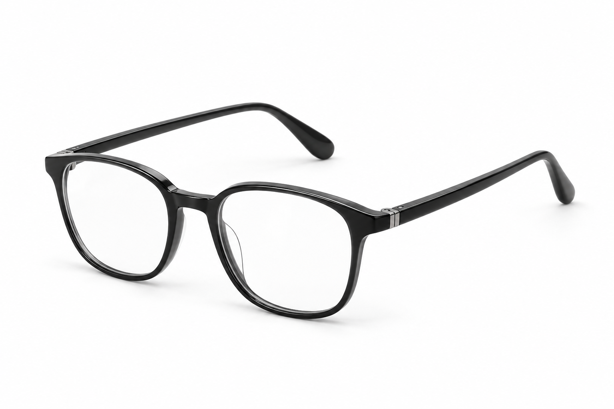
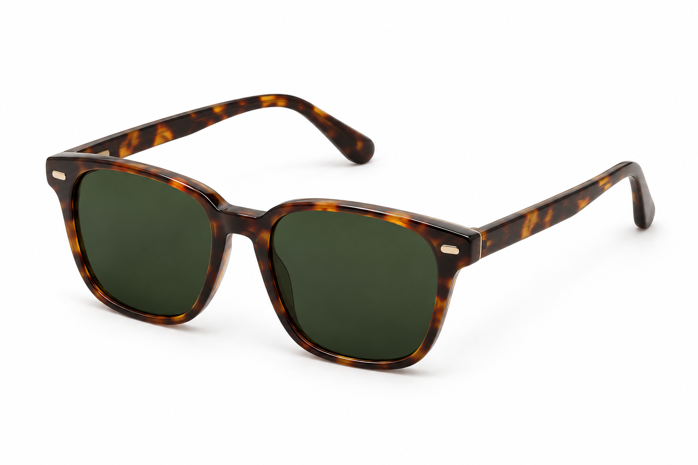

# Imágenes de estudio del primer paso · v1

Generadas el 06-11-2026 con `image_gen.imagegen` integrado, por solicitud del usuario: una sola montura óptica y una sola de sol, en perspectiva sobre fondo blanco. La autorización incluye conservar todos los assets anteriores.

## Archivos

| Categoría | Original conservado | Exports integrados |
| --- | --- | --- |
| Ópticos | [PNG1536×1024](lemoon-quiz-category-optical-studio-v1.png) | `assets/lemoon-quiz-category-optical-studio-v1-{480,960}.jpg` |
| Sol | [PNG1536×1024](lemoon-quiz-category-sun-studio-v1.png) | `assets/lemoon-quiz-category-sun-studio-v1-{480,960}.jpg` |

[Prompts completos](prompts.json) y [manifiesto web con dimensiones, bytes y SHA256](web-exports.json). Cuatro JPEG de calidad85, proporción3:2, sin recorte;194.399 bytes en total. Los originales generados también se mantienen en el directorio de generación de la herramienta.

## Dirección visual

Una sola montura por fotografía, perspectiva de tres cuartos, fondo blanco continuo y sombra de apoyo tenue. Ópticos con armazón oscuro y lentes claros; solares con armazón carey y lentes oscuros. Misma orientación, escala y luz, sin textos, marcas, props o pedestales.

Referencias de presentación consultadas: [Warby Parker Daisy](https://www.warbyparker.com/eyeglasses/daisy/jet-black) y [Harris](https://www.warbyparker.com/sunglasses/harris/oak-barrel). No se copiaron sus fotografías ni se incorporaron al tema. Son imágenes conceptuales generadas para categorías; no identifican SKU Lemoon ni acreditan materiales, prestaciones o stock.

## Integración y preservación

Solo cambia la rama `category` de `lemoon-quiz-options.liquid`: srcset480/960, sizes adaptado al ancho real, dimensiones960×640, contain, carga diferida y alt vacío porque el radio tiene su etiqueta HTML. La portada y las imágenes de uso no cambian. No se subió el tema a Shopify.

Los271 archivos que existían en `assets/` antes de esta tarea se verificaron por SHA256: ninguno eliminado ni modificado. En particular, `lemoon-category-opticos-generic-v1.jpg` y `lemoon-category-sol-generic-v1.jpg` siguen íntegros. El registro está en el directorio Git común de entrega `LEM-11-category-studio-2026-11-06`.

Verificación local:18/18 pruebas existentes de render/tarjeta y Theme Check sin ofensas. La revisión de navegador comprueba carga de ambas imágenes, encuadre completo, responsive y funcionamiento de los radios; no acredita publicación ni catálogo real.

## Vista previa

