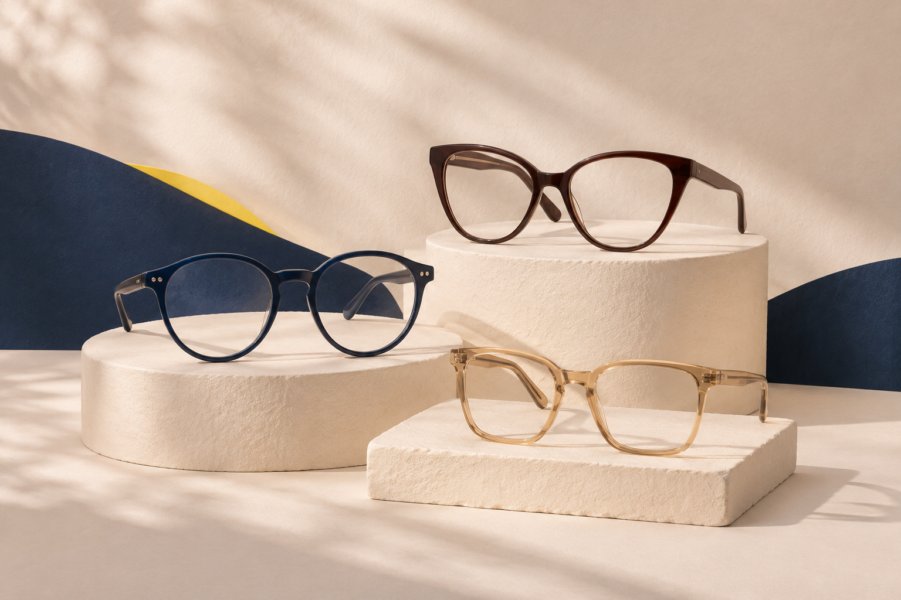
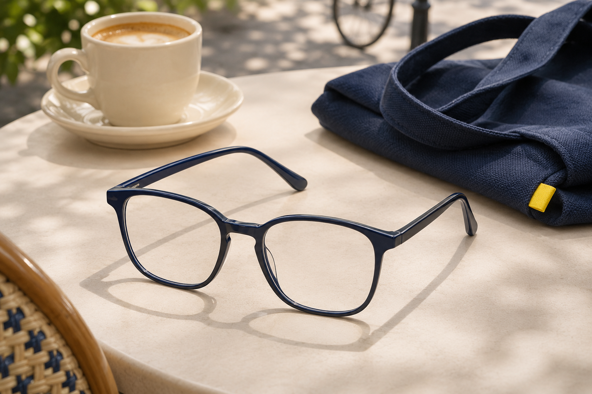
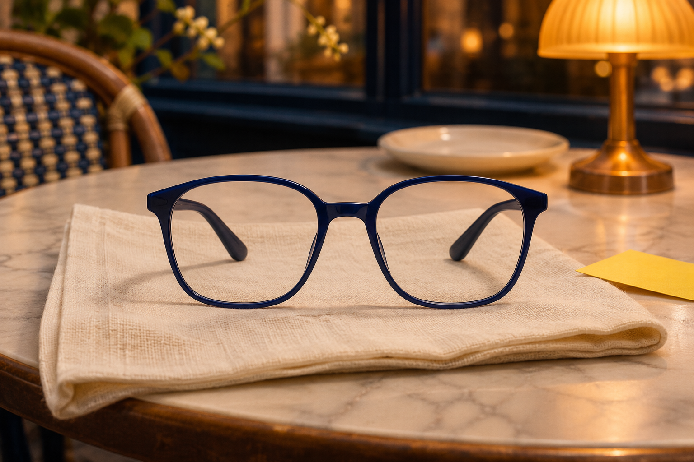
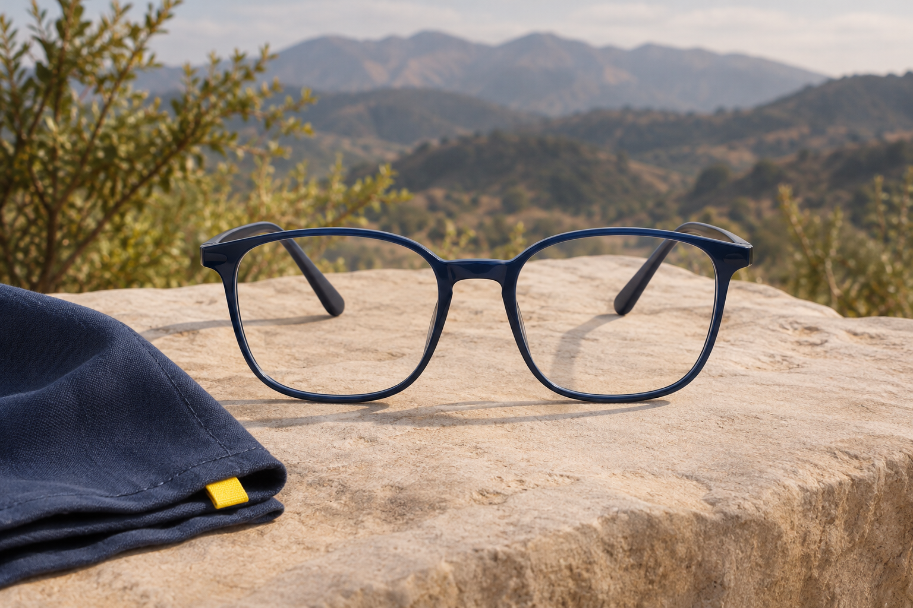

# Imágenes editoriales del quiz · v1

Generadas el 05-11-2026 con la herramienta integrada `image_gen.imagegen`, según la dirección aprobada «editorial con momentos lúdicos», [DESIGN](../../../../DESIGN.md) y la [guía de marca](../../brand-guidelines.md).

## Entrega

| Archivo | Destino integrado en el tema |
| --- | --- |
| [Portada](lemoon-quiz-hero-editorial-v1.png) | Invitación inicial: tres siluetas sobre superficies cálidas |
| [Trabajo o estudio](lemoon-quiz-work-editorial-v1.png) | Opción `use/work` |
| [Día a día](lemoon-quiz-everyday-editorial-v1.png) | Opción `use/everyday` |
| [Salir](lemoon-quiz-going-out-editorial-v1.png) | Opción `use/going_out` |
| [Aire libre](lemoon-quiz-outdoors-editorial-v1.png) | Opción `use/outdoors` |

Originales PNG 1536×1024, proporción 3:2. [Prompts completos](prompts.json). Se conservan las cinco imágenes por separado. Los [diez exports web](web-exports.json) están en `assets/`: portada 700×466 y 1400×933; cada escena de uso 480×320 y 960×640. Son conversiones JPEG a calidad 82 sin alterar la composición: 1.082.322 bytes entre todas las resoluciones; la portada pequeña pesa 61.258 bytes y las escenas pequeñas entre 44.163 y 55.177 bytes.

Son escenas conceptuales con armazones genéricos generados, no fotografías de productos disponibles ni evidencia de materiales, prestaciones o stock. Las cuatro situaciones mantienen una montura navy similar para concentrar la comparación en el contexto. No tienen texto incrustado; labels y significado se conservan en HTML.

## Revisión realizada y estado

Inspección visual de las cinco salidas: armazones completos, composición legible, ausencia de texto promocional, coherencia de paleta y contextos diferenciados. Se verificó copia idéntica de los originales y dimensiones.

El usuario solicitó integrar las cinco imágenes. `lemoon-style-quiz` usa la nueva portada como respaldo de la imagen configurable; `lemoon-quiz-options` muestra las cuatro escenas en uso. El contenedor conserva proporción 3:2 y `contain`, sin cortar los armazones. Las opciones mantienen checkbox/label, texto HTML, foco e indicador de selección. Las fotos de uso son decorativas, con alt vacío, carga diferida, srcset y dimensiones explícitas; las otras preguntas conservan sus SVG. Los productos de resultados mantienen su media comercial original.

La vista local se refresca con estos archivos. Esta integración no acredita carga en Shopify ni publicación en producción; su QA local se registra por separado a continuación.

### QA de integración local

- 30 pruebas unitarias del quiz y 13 E2E existentes pasan.
- Theme Check CLI 4.8.5: 306 archivos, cero ofensas al nivel warning; JSON y `git diff --check` válidos.
- Chromium a 320/390/820/1440px: las cinco imágenes cargan, srcset/currentSrc responsive, proporción 3:2 y contain, sin overflow ni errores HTTP/JavaScript.
- Clic sobre la imagen y selección con Space funcionan; foco visible de 2px, seis resultados de fixture y dos columnas móviles conservados.
- Capturas y resumen: `/tmp/lem11-image-integration-qa/`. Tester inspeccionó capturas móviles/escritorio; el integrador inspeccionó adicionalmente 390-use y 1440-intro. Revisión independiente de código/convenciones sin hallazgos P1/P2, en lectura por responsabilidad sin aislamiento técnico de permisos.

Estas pruebas renderizan Liquid real con objetos de catálogo de fixture; no acreditan datos comerciales, Shopify remoto ni Safari/Firefox/dispositivos físicos.

## Galería

### Portada

### Trabajo o estudio

### Día a día

### Salir

### Aire libre

