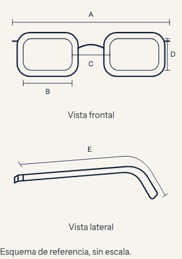
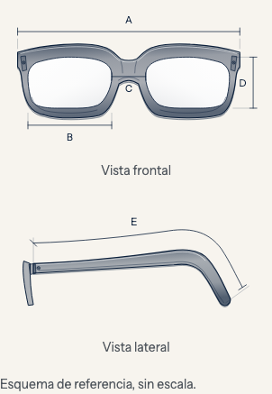
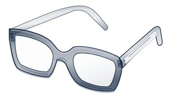

# LEM-129 / LEM-105 — revisión de los SVG de lentes

Revisión gráfica vigente: [lentes clásicos y planos](lem-129-105-classic-flat.md), código `b9611c8e`, según la indicación posterior de Miguel. Las capturas y resultados de este documento pertenecen a su revisión histórica; las URLs compartidas muestran el snapshot más reciente.

Petición de Miguel: dibujar los contornos desde unos lentes ópticos reales y acercar la representación al volumen de un armazón, superando el esquema de líneas anterior. Código de esta revisión: `26ba73f68c0bef7567990cc7f6c334df1b106380`, sobre `b844b602`. Es una corrección gráfica de los dos recursos compartidos del modal y la página.

## Referencia observada

Se abrieron tres fotografías oficiales del [Grover de Zeelool](https://www.zeelool.com/goods-detail/ZJGT078897-02): [frontal](https://s3.zeelool.com/admin/product/image/52168666826aa9b33a9db952e855c4f4.jpg), [tres cuartos](https://s3.zeelool.com/admin/product/image/f74ef7a7d87f8dfed1f98d40124ef97b.jpg) y [detalle editorial](https://s3.zeelool.com/admin/product/image/17f864d7d3f73860180a0308d45644c0.jpg). La ilustración nueva se dibujó con paths originales: ceja superior, estrechamiento inferior, puente, bisel, bisagras y curva de patilla. Las fotografías, logos y cifras del competidor no se incrustan en el SVG ni se presentan como datos Lemoon.

El frontal y lateral conservan proyección útil para las cotas A–E; planos de grosor, degradados navy y reflejos discretos aportan volumen. El bloque de comparación muestra el armazón completo en tres cuartos con la cara interior de la patilla visible. Los miniiconos siguen la misma silueta. Colores derivados de `currentColor` y del token de superficie existente; sin nuevos estilos globales.

## Comparación y capturas

| Antes | Frontal y lateral nuevos |
| --- | --- |
|  |  |

[Página completa a 1440 px](lem-129-105-realistic-svg/pagina-1440.png).

## Alcance y validación

Solo cambian `lemoon-frame-measurement-diagram` y el dibujo/miniiconos de `lemoon-size-guide-comparison`, más DESIGN, recetas e inventarios. Las cotas se anclan a los extremos de las aperturas y al recorrido de la patilla; los valores del producto, ejemplos HTML, textos, unidades, datos Shopify y controladores permanecen iguales. Los IDs de paths y gradientes están diferenciados por instancia. La cobertura de fuentes no cambia: 558 rutas,495 mapped y 63 excluded.

Comprobaciones del mismo contenido de los archivos que integran `26ba73f6`:

- Suite unitaria completa: **499/499**, 48 archivos, Node 24.19.0.
- Suite E2E afectada: **37/37** en Chromium, 32.8 s, puerto 4190. Modal estándar y óptico, inline, página, 390/820/1440, reflow 320, ampliación completa de textos y letras SVG al 200 %, foco/cierre/unidades y navegación.
- Theme Check con Shopify CLI 4.8.5: **316 archivos, cero observaciones**, umbral warning.
- Revisión independiente de código: Approved; referencias locales, IDs/escaping y semántica correctos.
- Revisión independiente de convenciones: Ready to push; tokens, contratos y documentación coherentes.
- Revisión independiente gráfica: Approved; comparación con fotos y capturas, forma/volumen y correspondencia de cotas comprobadas visualmente. El margen adicional del frontal mantiene D y su tick con aire y las letras completas al 200 %.

Las revisiones son de solo lectura por responsabilidad; no hay aislamiento técnico de capacidades verificado. No se añadieron pruebas que afirmen «realismo» mediante presencia de strings: esa cualidad se comprobó visualmente contra la referencia.

Logs: `/tmp/lem129-realistic-svg-unit.log`, `/tmp/lem129-realistic-svg-e2e.log`, `/tmp/lem129-realistic-svg-theme-check.log`. Informes y hashes de revisión en `.superpowers/sdd/2026-11-07-size-guide-pdp-page/realistic-svg-*.md`. Las 300 E2E globales de `1db003a4` son evidencia histórica de la implementación inicial; esta revisión gráfica ejecutó las 37 afectadas, sin atribuirse una nueva ejecución global.

## Preview vigente

Servidor local 4189 con snapshot `26ba73f6`, accesible con Tailscale conectado:

- [Modal PDP](https://miguels-mac-mini.tail51dddb.ts.net:9451/tests/fixtures/size-guide.html?shell=standard&scenario=complete): pulsar «Guía de medidas».
- [Página guía](https://miguels-mac-mini.tail51dddb.ts.net:9451/pages/como-medir-tus-lentes).

La URL es compartida entre revisiones y refleja el último snapshot servido; las capturas y SHAs conservan la evidencia de cada revisión. El contenido de fixture y sus medidas son sintéticos e identificados. No se subió ni publicó ningún tema. Los pendientes de Shopify/editor/SEO/catálogo y revisión humana de ambos tickets siguen registrados en [la entrega local](lem-129-105-size-guides-local.md); no se cambian por esta corrección gráfica.
