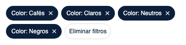

# LEM-153 — selección de afinidades y coherencia de variantes

Revisión del 14-11-2026. Candidato sobre `origin/develop` `07805c7920ef7c65b73c9be9bac2fd2fd75f6024`. La [PR72](https://github.com/antekera/lemoon-shopify-theme/pull/72) ya está fusionada; la corrección de ID numérico a GID no es un pendiente de integración. Este documento registra las correcciones posteriores y distingue el tema publicado del candidato local.

## Observación real anterior a este candidato

Lectura autenticada de `https://lemoon.cl`, tema publicado `155307737256`, sin escrituras de catálogo ni tema. Diccionario de21 entradas con GIDs válidos; catálogo sin restricciones de58 productos.

| Opción del quiz | Coincidencias observadas | Selecciones presentadas por Shopify |
| --- | ---: | --- |
| Negro | 0 | Sin chip |
| Neutros | 5 | Solo Cafés y miel; faltan los otros miembros de la familia emitida |
| Colores protagonistas | 5 | Chip presente |
| Bicolor | 0 | Sin chip |
| Plateado | 0 | Sin chip |
| Carey | 5 | Chip presente |
| Transparentes | 0 | Sin chip |

Neutros + brillante + Carey + diario + oversize devuelve Génova/Jade (2). Neutros + mate devuelve Estero/Faro (2). Colores protagonistas + brillante devuelve Ártico/Génova/Jade (3). La combinación contradictoria protagonistas + Carey devuelve cero en los cinco productos demo auditados, sin sumar atributos de sus variantes distintas. Estos conteos son una observación fechada, no expectativas permanentes para el catálogo comercial.

Las tarjetas con filtro único repetían el parámetro `variant`. Con protagonistas OR neutros, Shopify emitía enlaces de producto sin deep link y media genérica; después JavaScript seleccionaba Azul y añadía el enlace de variante, conservando la foto genérica. El JSON público de esos cinco productos identifica una fotografía de variante diferente. Los precios dentro de cada producto demo son iguales: la diferencia de precios se prueba con fixtures explícitas.

La suite ampliada de42 pruebas terminó contra ese tema anterior: **12 pases,30 fallos,0 omitidas**, con4 pases/10 fallos en cada ancho (390/820/1440). Los fallos se distribuyen en15 casos de chips ausentes,9 enlaces de variante no canónicos (8 duplicados y1 ausente) y6 fotografías incorrectas. Es evidencia del defecto publicado previo, no aceptación del candidato.

## Correcciones del candidato

- Conserva chips removibles para cada referencia seleccionada reconocida por el diccionario, aunque Shopify la omita de `active_values` por falta de asignaciones. No cambia el filtrado ni inventa coincidencias.
- Quitar un chip elimina solo su campo/valor, conserva las demás referencias y la ordenación y reinicia la paginación. Actualiza contador y reset después de AJAX e historial.
- La PLP comunica filtros de variante activos a la tarjeta. Imagen, precio, swatch y compra parten de la variante relevante nativa incluso con OR sin deep link; se conserva la media editorial en colecciones sin filtros de variante. Deep links y recomendaciones se validan contra las variantes del propio producto.
- Los enlaces swatch reemplazan `variant` sin duplicarlo y conservan otros parámetros.
- La aceptación verifica chips/remoción para los ejes deliberadamente ocultos del panel, en lugar de exigir checkboxes que el diseño vigente no ofrece. Compara también imagen, precio y enlace con el JSON público de la variante; ese JSON no certifica sus metacampos de afinidad.

## Verificación local

- 785/785 pruebas unitarias: incluye las siete opciones, las127 selecciones no vacías de colores por render numérico→GID→URL y regresiones de tarjetas con precios distintos, deep link ajeno, OR sin deep link y render de la PLP real.
- 46/46 pruebas Chromium de quiz, tarjetas y chips: incluye siete opciones individuales, alias neutrales, teclado/remoción nativa, historial, fallback sin JavaScript y seguridad de etiquetas.
- Theme Check local inicial:328 archivos, cero infracciones. CI con `@shopify/cli@4.8.5 --fail-level warning` detectó LiquidComplexity136>120; se extrajo el bloque de swatches a un snippet con inputs explícitos, conservando su comportamiento. La validación final con esa versión exacta de CI inspeccionó329 archivos sin infracciones.
- Back office sin modificaciones, revisión `49cf760`:16/16 pruebas de vocabulario, derivación y proyección. Herencia por criterio, reemplazo de grupo y separación de variantes conservados.
- Revisión independiente de código: Approved tras corregir el caso OR sin deep link. Convenciones: Ready to push. Ambas fueron revisiones conductuales de solo lectura con permisos heredados, sin aislamiento técnico impuesto.

Las regresiones de imagen/URL y chips fallaron antes del cambio y pasaron después. El validador Liquid del plugin no pudo ejecutarse por faltar `@shopify/theme-check-common`; se ejecutó el CLI nativo sin modificar el bundle.

Capturas de fixtures del candidato, no de Shopify publicado:

## Límites y aceptación pendiente

Las referencias sin clasificación continúan devolviendo el vacío real. Poblar atributos comerciales requiere evidencia y aprobación de las asignaciones exactas; no se modificó el catálogo para obtener resultados positivos. Los chips complementarios requieren JavaScript y un diccionario completo de hasta50 entradas. Sin JavaScript permanece el estado vacío nativo y el enlace para quitar todos los filtros.

No se publicó este candidato ni se ejecutó `theme push`. Las pruebas reales contra el tema anterior reproducen sus defectos; no son aceptación del Liquid corregido. Antes de cerrar LEM-153: aprobación humana de la revisión, integración/release autorizados, y ejecución de `tests/storefront/style-quiz.spec.js` sobre el candidato realmente publicado en escritorio, tablet y móvil. La aprobación de código no acredita la cobertura comercial completa ni el despliegue del back office.

Evidencia sanitizada adicional en el directorio Git común `delivery-evidence/lem-153-20261114/`: matrices por opción y combinación y datos públicos de las variantes. No incluye cookies ni credenciales.

Fuentes técnicas: [filtrado nativo y variante relevante](https://shopify.dev/docs/storefronts/themes/navigation-search/filtering/storefront-filtering), [límites de metaobjetos](https://shopify.dev/docs/api/liquid/objects/metaobject_definition), [paginación y parámetros independientes](https://shopify.dev/docs/api/liquid/tags/paginate).
